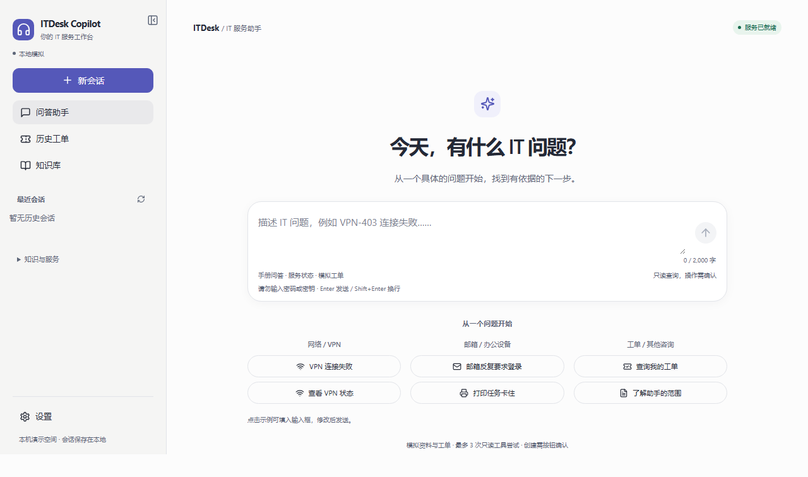
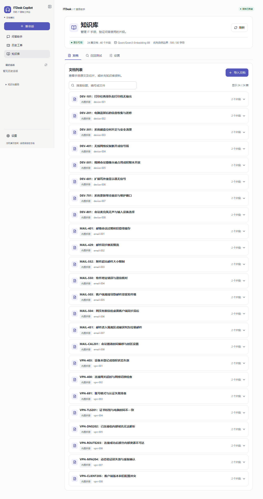
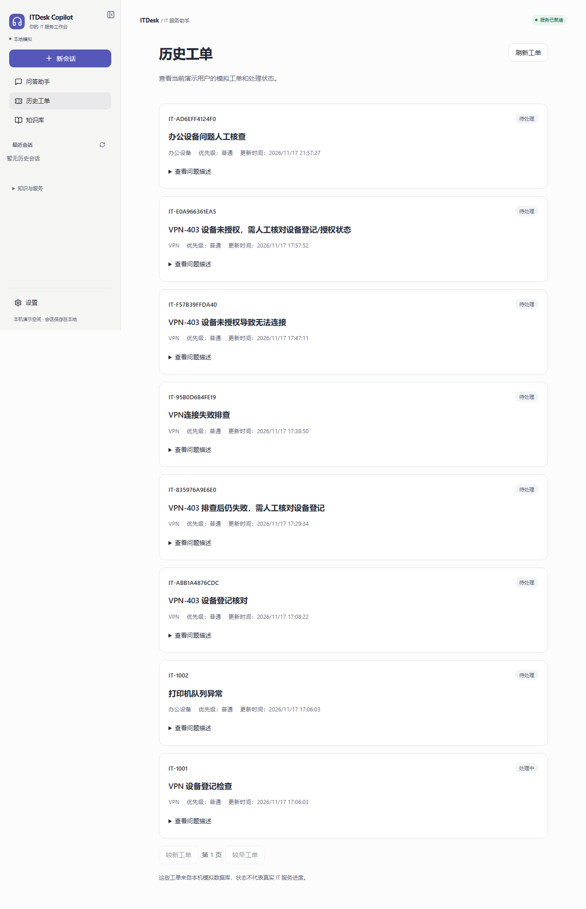
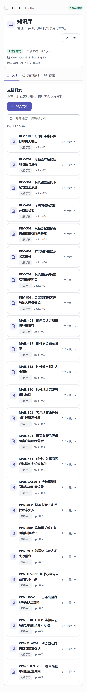
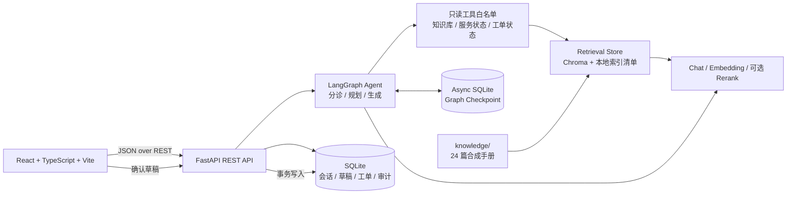
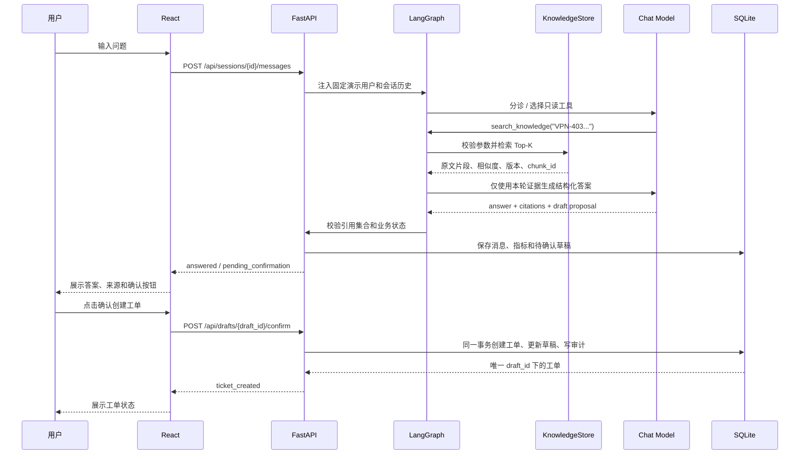

# ITDesk Copilot Lite

一个面向简历展示和本地复现的中文 IT 服务台助手。项目采用前后端分离架构：React + TypeScript + Vite 负责工作台，FastAPI + LangGraph 负责会话、检索和受控工具编排，SQLite 保存本地演示状态，Chroma 保存知识库索引。

> **v1.0.0 · Local demo**
>
> 所有手册、用户、服务状态和工单都是合成演示数据。项目没有接入企业系统，也不提供生产环境的登录、RBAC 或公网部署能力。

<div align="center">



*React 问答工作台：回答带证据引用，工单创建需要用户明确确认。*

</div>

## 这个项目解决什么问题

IT 服务台的常见请求通常需要同时查手册、确认服务状态、查看历史工单，再决定是否升级人工。这个演示把流程收敛成一条可观察的链路：

1. 用户在 React 页面描述问题。
2. FastAPI 调用有限的 LangGraph Agent，按需使用只读工具。
3. 检索结果保留原文、版本和片段 ID，生成答案时只能引用本轮证据。
4. 如果需要人工处理，系统只保存草稿；用户点击确认后，后端事务才创建模拟工单。

项目重点是边界和可验证性，而不是让模型直接执行高风险动作。

## 功能一览

| 模块 | 当前能力 |
| --- | --- |
| 问答助手 | 中文 IT 问答、引用原文、无证据时拒答、服务状态和当前用户工单查询 |
| 受控 Agent | 最多 3 次串行只读工具尝试，工具白名单、参数校验和结构化 JSON 输出 |
| 工单草稿 | 草稿与确认分离；确认接口只读取已保存草稿，重复确认返回同一工单 |
| 知识库工作台 | Markdown/TXT 导入、切片预览、Embedding/重排设置、召回测试、版本化发布 |
| 检索策略 | 向量检索 + 完整错误码精确命中；自然边界和固定窗口切片对照 |
| 可恢复状态 | 会话、草稿、工单和请求编号持久化，刷新页面可恢复已保存状态 |
| 前端体验 | 桌面端和移动端布局、搜索与折叠文档列表、加载/失败/超时状态 |

## 界面预览

| 问答首页 | 知识库工作台 |
| --- | --- |
|  |  |

| 历史工单 | 移动端知识库 |
| --- | --- |
|  |  |

截图来自当前 React 版本 `1.0.0`，不包含已归档的旧版界面。

## 整体架构



各层职责保持清晰：模型负责理解和生成，检索层负责证据，Agent 只做有限决策，业务层负责持久化和确认事务，前端负责展示状态与发起用户确认。

## 一条端到端链路

以“VPN-403 设备未授权，怎么排查？”为例：



模型不能直接写工单，也不能传入用户身份或权限字段；确认动作由固定接口和数据库事务完成。

## 关键设计取舍

### 1. 受控 Agent，而不是开放式自主执行

Agent 只允许调用三个只读工具，每轮最多尝试三次，且工具参数先经过 Pydantic 校验。这样保留了模型处理多步查询的能力，同时把“模型能做什么”限制在可审计范围内。普通函数足以处理完全固定的流程，但在“先检索手册、再查服务状态、最后生成回答”这类分支任务里，有限 Agent 能减少前端编排分支；代价是模型调用延迟和异常处理更复杂。

### 2. 向量检索叠加完整错误码匹配

语义相似度适合自然语言描述，完整错误码匹配适合 `VPN-403`、`MAIL-429` 这类稳定标识。系统先做向量召回，再把真实命中的完整错误码置顶并保留同文档相邻片段。相比单纯关键词检索，它能处理改写；相比纯向量，它减少错误码被相似文本淹没的情况。阈值、Top-K 和是否重排都可以在知识库工作台中调整，不能把某个默认阈值当成通用准确率保证。

### 3. 草稿和确认事务分离

模型只能提出草稿，不能创建工单。确认接口只接受空请求体，读取服务器已保存的草稿，在一个 SQLite 事务中写入工单、更新草稿状态和审计记录，并通过 `draft_id` 唯一约束保证重复确认幂等。普通的前端按钮锁定无法覆盖重复请求、刷新或网络重试，这个取舍用少量后端事务复杂度换取了明确的写入边界。

### 4. 工作台版本化发布

导入文档或修改 Embedding/切片设置时，后端先在独立版本中构建并检查新索引，成功后才切换当前版本；失败时继续使用旧索引。只调整召回和重排参数可以复用现有向量索引。这样比直接覆盖本地集合更容易恢复，也让问答和召回测试读取同一份已发布配置。

## 快速开始（Windows）

### 环境要求

- Python 3.11
- Node.js 22.12+ 和 npm
- 能访问所配置的 Chat、Embedding API；测试本身使用模型替身，不会联网调用模型

### 1. 安装后端

```powershell
git clone https://github.com/lkuko/itdesk-copilot.git
cd itdesk-copilot
powershell -ExecutionPolicy Bypass -File .\scripts\setup.ps1
```

脚本会创建 `.venv`、安装 `requirements.lock`，并在没有 `.env` 时复制 `.env.example`。真实密钥只填写到本地 `.env`，不要提交或粘贴到 issue。

### 2. 配置模型

编辑 `.env`，至少填写聊天和 Embedding 配置：

```dotenv
ITDESK_CHAT_BASE_URL=https://your-chat-provider.example/v1
ITDESK_CHAT_API_KEY=your-local-key
ITDESK_CHAT_MODEL=your-chat-model
ITDESK_EMBEDDING_BASE_URL=https://your-embedding-provider.example/v1
ITDESK_EMBEDDING_API_KEY=your-local-key
ITDESK_EMBEDDING_MODEL=your-embedding-model
```

可选的重排模型、CORS 和价格字段见 [.env.example](.env.example)。模型服务需要兼容 Chat Completions、标准 tool calling 和 Embedding 接口。

### 3. 检查并建立本地索引

```powershell
.\.venv\Scripts\python.exe -m app.cli doctor
.\.venv\Scripts\python.exe -m app.cli doctor --live
.\.venv\Scripts\python.exe -m app.cli index
```

`doctor` 只检查配置；`doctor --live` 和 `index` 会调用真实模型服务并可能产生费用。没有远端模型时，可以先运行测试和前端页面，测试使用替身数据。

### 4. 启动前后端

打开两个 PowerShell 窗口：

```powershell
# 窗口一：FastAPI
powershell -ExecutionPolicy Bypass -File .\scripts\start-api.ps1
```

```powershell
# 窗口二：React
npm --prefix frontend ci
powershell -ExecutionPolicy Bypass -File .\scripts\start-frontend.ps1
```

浏览器地址：

- [问答助手](http://127.0.0.1:5173/chat)
- [知识库工作台](http://127.0.0.1:5173/knowledge)
- [历史工单](http://127.0.0.1:5173/tickets)
- [FastAPI 文档](http://127.0.0.1:8000/docs)

服务默认只监听 `127.0.0.1`。前端不保存模型密钥，当前版本没有公网登录和访问控制。

## 测试与验证

```powershell
# Python 后端
.\.venv\Scripts\python.exe -m pytest -q
.\.venv\Scripts\python.exe -m ruff check app tests evaluation
.\.venv\Scripts\python.exe -m pip check

# React 前端
npm --prefix frontend run lint
npm --prefix frontend run build
npm --prefix frontend run test
npm --prefix frontend run test:e2e
```

Playwright 首次运行前安装 Chromium：

```powershell
npm --prefix frontend exec playwright install chromium
```

当前发布前的本地验证包括后端测试、前端 Vitest、Playwright 浏览器用例、TypeScript 构建和 ESLint。真实模型评测需要单独配置并产生 API 费用，历史评测材料不会被当作生产准确率或人工质量证明。

## 项目结构

```text
itdesk-copilot/
├─ app/                       # FastAPI、LangGraph、检索、业务持久化
├─ frontend/src/              # React 页面、API 层和交互状态
├─ knowledge/                 # 24 篇合成 Markdown 手册
├─ tests/                     # Python 单元、Agent、事务和评测测试
├─ frontend/tests/            # Vitest 与 Playwright 测试
├─ evaluation/                # 可复现的开发集、验收集和故障检查
├─ docs/                      # 架构、接口契约、演示与研究记录
├─ scripts/                   # Windows 安装和启动脚本
├─ .env.example               # 公开配置模板
└─ pyproject.toml             # Python 包和工具配置
```

## 安全边界与限制

- 知识库、服务状态和工单都是虚构演示数据，请不要输入密码、密钥或真实个人资料。
- 模型输出不是可信业务事实；后端会校验引用是否属于本轮检索结果，但这不等于答案语义一定正确。
- 工单创建需要用户确认，系统没有 SQL 执行、权限变更或真实 IT 系统写入工具。
- 本项目适合本地学习、简历演示和面试讲解，不应直接暴露到公网。
- 代码、测试和文档包含 AI 辅助协作内容；使用者应理解并能够独立解释、修改和验证自己在简历中描述的部分。

## 适合简历的项目描述

> 使用 React、TypeScript、FastAPI 和 LangGraph 构建前后端分离的 IT 服务台助手。实现带原文引用的知识问答、有限只读工具编排和需确认的工单草稿流程；通过请求编号恢复结果、SQLite 事务与唯一约束保证重复确认幂等；在同一语料和 Embedding 模型下对比自然边界与固定窗口切片，并用浏览器、事务和故障注入用例验证关键边界。

项目的真实负责范围应按本人能够独立复现和解释的内容填写，不能把模型、LangGraph、Chroma 或 SQLite 的基座能力表述为自研框架。

## License

MIT License，详见 [LICENSE](LICENSE)。
