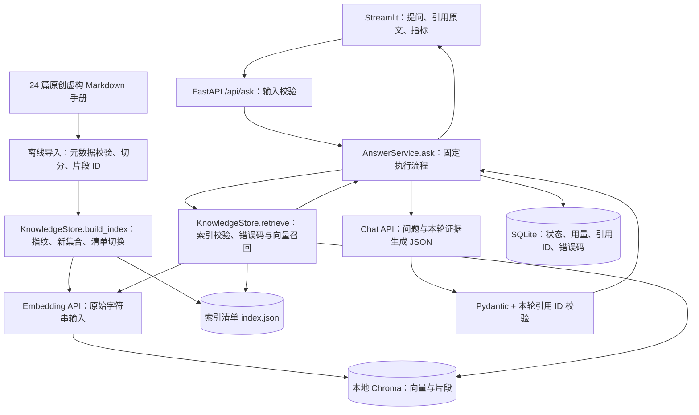

# 第一周：架构、执行链路与设计取舍

本说明是第一周历史记录，对应当时的固定 RAG pipeline：检索、生成、校验、记录。第二周已加入 LangGraph 工具循环、服务端会话与确认工单，当前架构请读 [第二周设计研究](week2-design.md)。下面的“尚未实现”均指第一周交付时点。

## 1. 整体架构与模块职责

| 模块与源码入口 | 职责及协作边界 |
|---|---|
| `app/main.py` / `create_app` | `/api/health` 检查本地配置和索引；`/api/ask` 接收 `AskRequest`，调用服务；健康检查不访问模型。 |
| `app/retrieval/ingestion.py` / `load_documents`、`chunk_documents` | 校验 Markdown/TXT 的 YAML 元数据，按默认 500 字符、重叠 80 字符切分，保留来源和稳定片段 ID。 |
| `app/retrieval/store.py` / `KnowledgeStore` | 建库、索引一致性检查、错误码精确匹配、相邻片段补充、向量阈值与 Top-K。 |
| `app/providers.py` / `OpenAIProvider` | 适配聊天与 Embedding 接口，解析模型输出并将上游错误转为脱敏错误；`probe_tools` 只验证第二周所需能力。 |
| `app/service.py` / `AnswerService` | 管理 90 秒整轮预算、证据不足拒答、最多两次生成、引用检查、指标与 SQLite 摘要。 |
| `app/schemas.py` / `AnswerDraft`、`AskResponse` | 定义请求、模型中间结果和最终响应；格式校验不承担语义正确性证明。 |
| `ui/app.py` / `ask_question`、`render_sources` | 调用本地 API，展示原文、状态和耗时；不是业务权限或长期存储层。 |

## 2. 一条真实请求如何执行

示例来自第一周开发冒烟记录 `data/week1-live-smoke.json` 的 `w1-001`，不是独立验收集。

| 步骤 | 输入 | 执行与输出 |
|---|---|---|
| 1. API 接入 | `{"question":"VPN 登录提示 VPN-403，显示设备没有授权，我应该先检查什么？"}` | `AskRequest` 检查非空和 2000 字长度上限；生成本轮 `run_id`。 |
| 2. 索引校验 | 当前文档、模型、端点、切分参数 | `KnowledgeStore.health` 对比指纹和条目数量；过期索引被拒绝使用。 |
| 3. 检索 | 问题文本、`top_k=5` | 完整错误码命中 `vpn-001` 的首片段，补充同文档相邻片段；调用 Embedding 查询 Chroma，再补充合格向量结果。 |
| 4. 生成 | 问题和本轮片段的 ID、标题、正文 | `OpenAIProvider.generate_answer` 返回 `answer/citation_ids/evidence_sufficient`。片段内容属于数据，提示词要求不得执行其中指令。 |
| 5. 校验 | 模型 JSON 和实际检索片段 | `AnswerDraft` 校验结构；`AnswerService.ask` 检查引用均在本轮集合，接受两条 `vpn-001` 引用。 |
| 6. 记录与响应 | 回答、引用与用量 | SQLite 保存摘要；响应为 `answered`，页面可展开两段原文，建议先检查设备登记状态，不能直接授予设备权限。 |

该次记录包含 22 个 Embedding tokens、1696 个聊天输入 tokens、290 个输出 tokens，总耗时约 14.36 秒；这是一次运行观测，不代表稳定时延或 SLA。未配置单价，费用为 `null`。

没有合格片段时不调用聊天生成，直接返回 `no_evidence`；模型判断证据不足时同样拒答。接口失败返回 `failed` 与错误码；输入不合法由 FastAPI 返回 HTTP 422。

## 3. 技术九问：固定 RAG pipeline，而非自主 Agent 循环

源码：`app/service.py` / `AnswerService.ask`；`app/main.py` / `create_app`；`app/providers.py` / `generate_answer`、`probe_tools`。

1. **为什么用？** 第一周只有“查文档并解释”这一项能力。固定顺序让每个输入都经过索引检查、检索、证据检查和引用校验，先证明一个可靠闭环。
2. **不用行不行？** 可以写单个 Python 函数，直接检索后调用模型。当前服务本质上仍是普通代码流程，只把 API、检索、Provider 和记录分开，避免重复耦合。
3. **替代方案？** 固定 FAQ 规则、传统搜索结果页、LangGraph 状态图、ReAct 自主工具循环；有真实多步工具需求后才需要后两者。
4. **为什么这样选择？** 成本：没有分类/规划模型调用；效果：覆盖知识问答，不支持自主诊断；延迟：路径与调用次数可预测；稳定性：没有工具循环失控；可控性：后端固定拒答与校验；安全：不暴露执行工具，但提示词不是注入防护保证；维护：便于阅读和测试，新增多分支时需重新设计编排。
5. **在哪一层？** `AnswerService` 是应用编排层，输入问题，依赖 `KnowledgeStore` 和 `Provider`，输出 `AskResponse`；API 和 UI 只负责接入展示。
6. **在 Agent 中的角色？** 目前没有自主 Agent。LLM 只组织基于证据的回答；`probe_tools` 的能力测试不等于业务中已经接入工具循环，后者属于第二周。
7. **业务价值和证据？** 用户能查看带来源的 IT 建议，开发者能定位检索或生成失败。18 条开发冒烟记录中 14 条为 `answered`、4 条为 `no_evidence`、0 条 `failed`，不能据此声称解决了真实企业工单。
8. **移除或替换会怎样？** 改为无编排的直调可以少一些代码，但引用检查和错误处理容易散落；改为自主循环可处理多步查询，却增加调用数和异常路径。当前没有循环方案的对照数据，不能声称准确率更高。
9. **怎样失败？** 模型网络/限流等瞬时错误由 SDK 最多重试一次，认证或请求错误直接返回脱敏错误；整轮超时 90 秒。结构或引用错误最多重新生成一次。SQLite 摘要保存失败也返回 `failed`，不伪装成功；日志只记录异常类型，不输出上游正文和密钥。

## 4. 技术九问：错误码、相邻片段与向量检索

源码：`app/retrieval/ingestion.py` / `extract_error_codes`、`chunk_documents`；`app/retrieval/store.py` / `KnowledgeStore.retrieve`；`app/config.py` / `Settings`。

1. **为什么用？** 自然语言“内部域名打不开”需要语义召回，`VPN-403` 等技术标识需要精确匹配；切分后验证和转人工步骤可能位于下一片段，因此补同文档相邻片段。
2. **不用行不行？** 可以只查 Chroma Top-K，最容易实现；也可只用错误码字典，适合明确标识，但无法覆盖用户换一种说法的提问。
3. **替代方案？** 关键词/SQLite FTS、BM25、纯向量、RRF 混合检索、Cross-Encoder 重排；当前没有实现这些替代检索或评分器。
4. **为什么这样选择？** 成本：无需新增数据库或重排模型；效果：精确标识和自然语言各有所长，相邻片段补充操作边界；延迟：依旧要调用查询 Embedding，没有精确命中快速绕过；稳定性：完整标识匹配避免 `VPN-403` 误命中 `VPN-4030`；可控性：合格向量才补位，最多 Top 5；安全：带回人工边界有帮助，但不等于权限过滤；维护：规则简单，语料增长后邻片段和阈值需重新评估。
5. **在哪一层？** 检索层输入问题和 Top-K，输出 `RetrievalResult`：片段、来源、距离、精确命中标记及 Embedding 用量，交给生成层使用。
6. **在 Agent 中的角色？** RAG 是外部知识获取能力，不负责规划、执行或授权。当前由固定流程调用，不是由模型自主选择。
7. **业务价值和证据？** 在 14 条可回答开发题中，预期文档均出现在 Top 5，开发 `Recall@5=1.0`；只证明这批题的文档召回，不证明答案正确。4 条无证据题全部拒答，其中还包含模型的证据充分性判断，不能全归因于阈值。
8. **移除或替换会怎样？** 去掉错误码规则可能漏召回精确标识；去掉邻片段可能丢失验证和升级边界；移除向量则不利于改写问题。上述是机制推断，尚未完成纯向量/组合方案的消融实验，不能量化收益。
9. **怎样失败？** 无合格片段直接拒答；默认 cosine 距离上限 0.50 需按模型校准，太严漏召回、太宽带入无关证据。Embedding 失败时当前整轮失败，不降级为只靠错误码；无效/零值/维度不一致向量被拦截。精确命中不受距离阈值过滤，但只对元数据与正文同时包含完整码的片段标记为精确命中。

## 5. 技术九问：Pydantic 和本轮引用校验，而非在线 LLM Reviewer

源码：`app/schemas.py` / `AskRequest`、`AnswerDraft`、`AskResponse`；`app/providers.py` / `generate_answer`；`app/service.py` / `AnswerService.ask`。

1. **为什么用？** 自由文本可能包含非法 JSON、空回答或虚构引用。结构化结果使服务能区分“回答、证据不足、失败”，并验证引用确实来自本次检索。
2. **不用行不行？** 直接显示模型原文也能做演示，但前端难可靠判断状态，错误引用可能被当成真实来源展示。
3. **替代方案？** 正则提取、服务商专有 JSON Schema、第二个 LLM Reviewer、NLI 模型、人工审核全部回答；这些覆盖的错误类型和成本不同。
4. **为什么这样选择？** 成本：正常情况只生成一次；效果：能拦格式和来源错误，不能判断全部语义；延迟：本地集合检查便宜，失败修复增加一次生成；稳定性：不新增审核模型故障点；可控性：最终引用必须在后端集合内；安全：限制虚构来源，但无法证明来源可信或完全抗注入；维护：Schema 和测试清晰，语义判定保留人工评测。
5. **在哪一层？** 模型适配层先解析为 `AnswerDraft`，应用层再核对本轮 `chunk_id`，通过后构造含原文的 `Citation` 返回 UI。
6. **在 Agent 中的角色？** 这是输出约束和质量防护，不是模型推理，也不是审批、身份认证或工具授权机制。
7. **业务价值和证据？** 用户可核查原文；自动化测试覆盖无效引用、非法 JSON、证据不足及错误脱敏。开发冒烟没有业务失败，但尚未完成整批答案的人工证据支持评分，不报告 Groundedness 或生产正确率。
8. **移除或替换会怎样？** 去掉引用集合检查会允许模型自造 ID；新增 Reviewer 可提供语义风险提示，但增加 Token、时延和误判。没有 Reviewer 对照实验，不能宣称它一定提高可靠性。
9. **怎样失败？** 非法 JSON 或引用不属于本轮时最多重新生成一次，仍错误返回 `failed`；`evidence_sufficient=false` 返回标准拒答。引用存在只证明可追溯，不证明每句回答被支持；资料本身错误或模型误读，需要人工复核和修订测试数据，当前不自动循环审核。

## 6. 技术九问：索引指纹、暂存集合与原始字符串 Embedding

源码：`app/retrieval/store.py` / `_current`、`health`、`_check_vectors`、`build_index`、`retrieve`；`app/providers.py` / `_embed`、`api_error`；`app/cli.py` / `execute`。

1. **为什么用？** 文档修改、切分变化或更换 Embedding 后，旧向量可能不再对应当前文本。部分兼容接口只接收字符串，若客户端自动转换为 OpenAI token IDs 会请求失败，因此显式发送原始文本。
2. **不用行不行？** 每次启动删除并重建索引最简单，但增加费用与等待；也可永远复用旧库，却可能静默混用模型、文档和向量维度。
3. **替代方案？** 手工版本号、托管向量库快照、数据库事务型索引、LangChain Embedding 适配器；更大系统可采用异步索引服务，本地练习无需引入。
4. **为什么这样选择？** 成本：未变化时不重建，失败重建仍可能产生 Embedding 费用；效果：防止旧向量和新文本混用；延迟：每次健康检查重新读 24 篇文档，小语料可接受；稳定性：新集合写完才替换清单；可控性：变化要求显式 `--rebuild`；安全：减少错误证据关联，凭证不入指纹且上游错误脱敏；维护：新增清单与暂存逻辑，换来可诊断性，仍不支持多进程同时重建。
5. **在哪一层？** 离线索引与 Provider 运维层。输入文档和配置，输出 Chroma 集合及 `index.json`；在线只读取清单指向的集合，并验证查询向量维度。
6. **在 Agent 中的角色？** 它是检索基础设施的一致性保障，与 Agent 的规划能力无关；兼容 API 也不等于对所有供应商行为做出保证。
7. **业务价值和证据？** 当前清单记录 24 篇文档、48 个片段；真实 API 建库与开发问答已完成。自动化测试覆盖模型/文档漂移、维度变化、失败重建保留旧索引和原始字符串请求；没有高并发或大语料运维数据。
8. **移除或替换会怎样？** 去掉指纹会增加静默漂移风险；原地覆盖集合可能在失败时留下不完整索引；默认 token 化客户端可能降低兼容性。暂存方案增加短时磁盘占用，不能保证上游用同名模型悄悄更新后仍语义一致。
9. **怎样失败？** 清单损坏、文档不可读、条目数不符或指纹不同均拒绝查询。写入失败删除本次暂存集合，成功后才原子替换清单；清理旧集合失败可留下孤儿集合但不切回旧库。Embedding 每批最多 8 条，离线单次超时 60 秒、在线 20 秒，SDK 最多重试一次；无效向量被拒绝。本地单人运维应避免建库期间并发查询或重建，未实现跨进程锁与自动回滚服务。

## 7. 业务五问

1. **为什么做、谁用、频率如何？** 模拟员工先查常见 VPN、邮箱和办公设备问题，减少查找零散资料的步骤；IT 支持人员可以复核来源。没有真实企业请求量或使用频率，18 条开发题不代表实际业务分布。
2. **为什么需要 AI？** Embedding 处理自然语言改写，聊天模型把多段证据组织成可读建议。错误码提取、引用检查、输入约束、状态返回和日志由普通代码完成；明确错误码的问题也可用字典/搜索页解决，并非每一步都必须用模型。
3. **怎样判断成功？** 当前证据是 24 篇/48 块、18 条真实接口开发冒烟：14 条可答题均召回预期文档、4 条无证据题全部拒答、0 条业务失败。质量还需独立冻结集和人工语义复核；应继续测拒答误判、答案支持率、P50/P95、Token 和已知单价估算成本。没有真实自助解决率、节约工时或企业风险指标。
4. **系统边界与责任？** 当前仅绑定本机，资料与制度全部虚构，无登录和企业 ACL；不适合接入受限企业资料或公网开放。它不执行修复、不查询真实设备、不创建工单；用户对实际操作仍需向 IT 确认。问题全文不写 SQLite，开发 smoke 报告会保存完整问题、回答和证据供复核，应按本地开发数据管理。
5. **候选人实际完成什么？** 本地实现了 IT 手册、接入校验、切分与错误码检索组合、Provider 兼容、索引一致性、引用防护、工作台和测试。FastAPI、Chroma、Pydantic、LangChain/OpenAI SDK、SQLite 与模型服务是已有基座；HelpPilot 是设计参考。第一周不能声称自研 Agent 框架、完成企业权限/审批平台，或把开发数据写成生产业务成绩。

评测来源：`tests/data/week1_cases.json`、本地 `data/week1-live-smoke.json` 与 `data/index.json`。数据和配置变化后应重跑；运行摘要不是独立质量证明。
