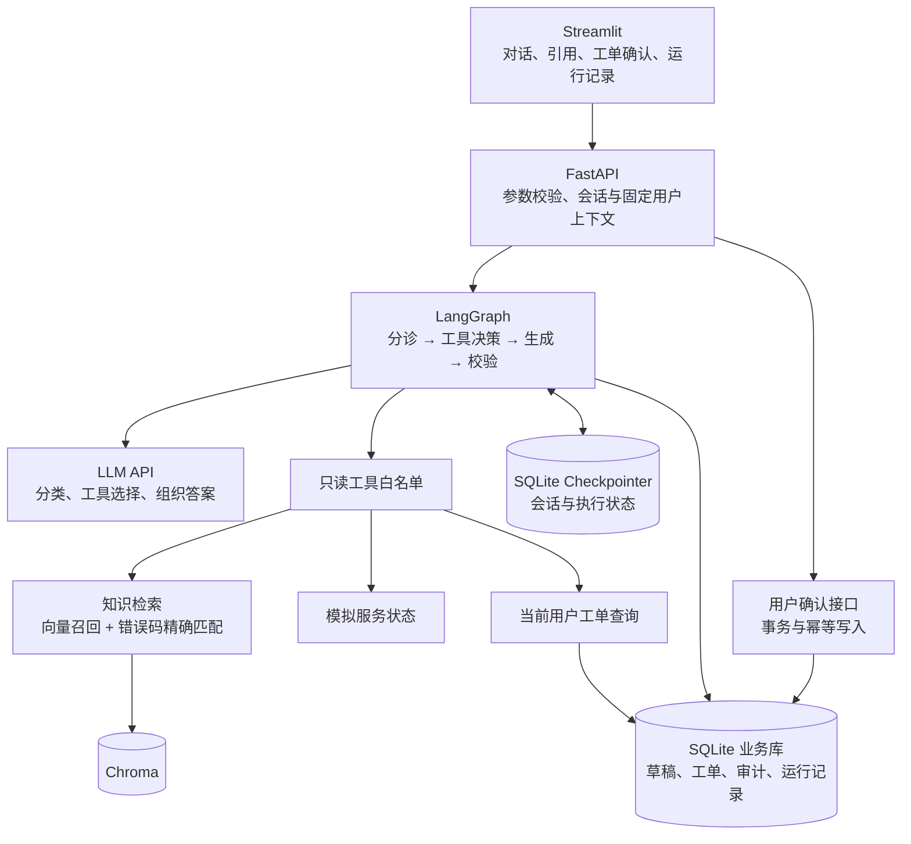

# ITDesk Copilot Lite 开发方案

## 当前开发计划：以前后端分离的 IT 服务台为简历项目

项目解决员工遇到 IT 故障时来回翻手册、查状态和反复描述问题的麻烦。一次演示走完「提问 → 查看手册原文 → 发现问题未解决 → 编辑草稿 → 确认创建模拟工单」。React + TypeScript + Vite 负责页面与交互，FastAPI 负责参数校验、模型与业务状态。保留一个仓库和两个本地启动进程，Python 继续承担 Agent、检索和事务。前后端分离的成本是两套依赖和同步接口字段，验收收益是页面交互、错误恢复和后端规则可以分别验证。

| 阶段 | 交付与验收 | 简历讲什么 |
|---|---|---|
| 第 1 阶段：前后端契约 | React 和 FastAPI 分别启动。通过 HTTP 验证健康检查、聊天基本路径和错误响应。React 基础迁移已有验收记录。 | 前端如何呈现超时和结果未知，服务端如何避免重复请求触发模型。 |
| 第 2 阶段：服务台闭环 | 用虚构 IT 手册完成问答、引用核对和查询，再由用户编辑并确认创建模拟工单。复现重复确认、无证据和模型超时。 | 为什么让模型选择有限的只读工具，由普通代码执行事务。如何证明一次确认只创建一个工单。 |
| 第 3 阶段：知识库实验 | 浏览手册与切片；同一语料、模型、窗口、重叠和查询下，比较固定字符窗口与自然边界。展示 Top-K、余弦相似度、片段原文和用量。在一批预先标注问题上记录 Recall@K、首个命中排名、证据完整性和片段数。 | 切片为何会影响证据完整性，怎样控制变量，遇到收益持平或退化时怎样决定。 |
| 第 4 阶段：验收与演示 | 跑前后端和 HTTP 回归，复演一条成功和一条失败链路，更新架构图、源码索引、技术九问和业务五问。Telegram 仅作只读问答的本地协议演示。 | 按实际完成情况交代本人、AI 协作、开源参考和框架能力。用评测记录支撑量化结论。 |

四阶段用于分次开发和独立复现，学习量建议按约 7–10 个有效开发日规划。核心只讲四项技术取舍：React/FastAPI 接口与失败恢复、单 Agent 与只读工具、切片与可追溯检索、草稿和幂等事务。Telegram 作为扩展讲解，部署、多用户和更复杂的 Agent 另行立项。现版架构、链路与自检见 [React 设计与源码](react-design.md)，讲解顺序见 [简历与面试准备](resume-project.md)。待评价的企业价值是减少查找和升级工单的耗时，需要实际用户任务和原流程对照才能检验。项目中的样本、模型评测和本地协议测试分别记录。

### 当前目录

```text
itdesk-copilot/
├─ frontend/src/                # React 页面、路由和 REST Client
│  └─ features/knowledge/       # 文档预览、片段位置和两组 Top-K
├─ app/                         # FastAPI、Agent、事务和 Telegram 适配
│  └─ retrieval/                # 切片、问答索引和独立实验
├─ knowledge/                   # 本地模拟 Markdown 手册
├─ evaluation/                  # 开发题、真实 Embedding 对照和历史模型评测
├─ tests/ 与 frontend/tests/     # 后端、浏览器和跨进程集成测试
└─ docs/                        # 计划、架构、验收与简历材料
```

从已完成的 React 基座继续开发。旧原型已退出启动流程，恢复方法记录在项目内。近期对照和本地机器人验证结果可直接复盘。[旧原型归档](streamlit-retirement.md) · [知识库实验与验收](knowledge-lab.md)

## 历史迁移计划：React 前后端分离

2026-11-18，用户将简历展示重点调整为前后端分离。本轮采用React + TypeScript + Vite作为主要演示前端，保留FastAPI、单Agent、三个只读工具、Chroma和SQLite；Streamlit暂留调试入口。运行目标为本机FastAPI 8000 + Vite 5173双进程，继续固定演示用户，不增加登录、多用户、SSE/WebSocket、Docker或生产部署。

迁移按四个阶段执行：①前端工程/API契约/受限CORS；②聊天与会话、引用与工具记录、请求超时和编号恢复；③草稿编辑/确认/取消、历史工单、localStorage显示偏好及前端测试；④前后端回归、桌面/手机实屏、演示和简历材料。四阶段是任务组织方式，不是候选人已连续投入四周的履历证明。

当前整体架构、端到端输入输出、五项技术取舍与技术九问、业务五问见[React设计研究](react-design.md)，字段和错误协议见[React/FastAPI联调契约](react-api-contract.md)。当前草稿允许先PATCH保存修改，再以空body确认已存草稿；本段和现版源码优先于下文v1原型的旧约束。最新运行/测试和验收见[React交付记录](react-delivery.md)，启动入口由[README](../README.md)维护，不把历史成绩当作本轮重跑。

### 简历目标与难度控制

本轮不重写已完成的Agent与检索后端，主要工作是替换展示层、明确HTTP契约，并把跨页面状态和失败交互做完整。目标是候选人能独立启动、演示、画图和解释四条链路：知识问答、模拟服务状态、已有工单查询、草稿确认创建。前端使用React组件、TypeScript类型、原生fetch和普通CSS；不为简历增加状态管理框架、微服务或分布式基础设施。

简历优先讲清四个技术点：前后端契约与错误处理、有限只读Agent、可追溯检索、请求恢复与事务确认。主题和显示设置作为交互完整性的补充，不必与核心技术点等量展开。本人独立完成、AI辅助完成和框架已有能力须按实际复现情况填写。

### 四阶段交付与验收

| 阶段 | 具体开发内容 | 必须交出的结果 | 验收条件 |
|---|---|---|---|
| 1. 工程与接口 | 建立React/TypeScript/Vite工程；统一API base URL、请求/响应类型、错误映射；FastAPI配置明确Origin的CORS。 | 可启动页面、API契约、独立前后端启动步骤。 | 前端完成类型检查与构建；本机页面能读取健康接口；不可信Origin无跨域读取许可；前端不保存模型凭证。 |
| 2. 对话与会话 | 聊天、历史、重命名/删除、引用原文、只读工具记录；添加提交中/失败/结果未知状态和原请求编号恢复。 | 可完整演示问答/状态/工单查询，刷新可恢复已保存消息。 | 推荐只预填；发送中防重复操作；200但业务failed能明确呈现；超时先查持久化结果，已完成请求重试不再调用模型，中断旧请求需用户明确以新编号发起。 |
| 3. 草稿与浏览器偏好 | 草稿编辑/保存/确认/取消、历史工单；8项显示设置及版本化localStorage；API/偏好/请求恢复测试。 | 用户核对后的完整建单链路、工单页和设置页。 | 保存草稿不建单；确认只发送草稿编号和空body；重复确认不重复创建；取消后不能确认；偏好保存成功才应用，刷新保留，存储拒绝时不提前应用。 |
| 4. 回归与展示材料 | 后端回归、前端测试、关键浏览器流程、桌面/手机检查；整理架构、链路、源码、失败案例和简历。 | 本轮交付记录、可复现命令、截图/演示脚本及真实负责范围。 | 四条链路可复现；模型/工具/数据库失败有明确反馈；记录实际执行结果，区分mock、规则、真实模型和历史成绩；不把界面迁移写成模型质量提升。 |

建议将学习与复现安排为约 **7–10 个有效开发日、每天2–3小时**，按已有能力调整；这是后续投入估计，不是本轮已耗时或完成证明。每阶段验收后再进入下一阶段，发现问题优先修复，不追加高级功能。模型质量沿用历史证据并标明版本；本轮没有新的模型改动时，不为界面验收重新跑完整付费评测。

### 迁移时源码目录与职责

```text
itdesk-copilot/
├─ frontend/                       # 独立Node工程，主要演示入口
│  ├─ src/app/                     # App、路由、会话与未决请求协调
│  ├─ src/api/                     # fetch、类型、错误和有限展示遮蔽
│  ├─ src/features/chat/           # 消息、引用、工具记录与请求恢复
│  ├─ src/features/sessions/       # 重命名与删除交互
│  ├─ src/features/drafts/         # 编辑、保存、确认、取消和状态核对
│  ├─ src/features/tickets/        # 工单列表与详情
│  ├─ src/features/settings/       # 显示偏好读写和设置页
│  └─ tests/                       # 前端逻辑与浏览器流程
├─ app/
│  ├─ main.py                      # FastAPI接口、校验与CORS
│  ├─ agent.py                     # 受限单Agent执行图
│  ├─ tools.py                     # 三个只读工具及参数校验
│  ├─ retrieval/                   # 手册切分、索引和召回
│  └─ business.py                  # 会话、消息、草稿、工单和事务
├─ tests/                          # 后端/API/故障回归
├─ evaluation/                     # 历史数据、运行结果和AI辅助复核
└─ docs/                           # 设计、开发安排、证据与简历材料
```

采用一个仓库中的独立前后端目录即可，不要求拆成两个Git仓库。Streamlit原型和历史评测仍可用于排查与对照；当前功能和字段以React设计/API契约及实际源码为准。

## 原三周与追加第四周：历史计划

前三周是已完成的v1范围。2026-11-17，用户追加第四周“修复已知问题、定向回归与完善演示”，具体任务和验收证据见[第四周计划](week4-plan.md)。这是后续迭代，前三周的冻结数据与首轮成绩保持历史原样。

## 1. 目标、范围与技术栈

用约 **3 周、每天 2–3 小时**，完成一个适合简历展示的本地项目：员工描述 IT 问题，系统检索资料、查询状态、提供建议，并在用户确认后创建模拟工单。

第一版完成四条业务链路：

| 链路 | 用户操作 | 系统结果 |
|---|---|---|
| 知识问答 | “VPN-403 怎么处理？” | 返回排查建议、引用文档 |
| 状态查询 | “现在邮箱服务正常吗？” | 查询模拟服务状态并解释 |
| 工单查询 | “我的 IT-001 处理了吗？” | 查询当前用户的模拟工单 |
| 工单创建 | “帮我报修电脑” | 生成草稿，用户确认后创建工单 |

采用：**Python 3.11、FastAPI、Streamlit、LangGraph、Chroma、SQLite、Pydantic、langchain-openai、pytest**。模型与 Embedding 分别配置兼容 OpenAI 的 API。

项目目录使用仓库根目录，使用独立虚拟环境和依赖锁定文件，保留现有研究目录。

范围控制：

- 单 Agent，最多调用 3 次只读工具。
- 使用虚构 IT 手册、模拟服务状态和模拟工单。
- 本地固定 Demo 用户，后端注入身份；不实现登录、SSO、完整 RBAC。
- 不接生产系统，不实现权限开通、多 Agent、重排模型、任务队列或独立 LLM Reviewer。
- 第一版通过两个本地进程启动，不要求 Docker 或云部署。

## 2. 架构、执行流程与接口

### 整体架构



### Agent 执行流程

```text
接收问题、恢复会话
→ 分诊：问题类别、意图、优先级建议、缺失信息
→ 模型选择只读工具
→ 后端校验并执行，返回事实
→ 最多重复 3 次
→ 单独生成结构化答案或工单草稿
→ 校验引用、字段和业务状态
→ 保存记录并返回
```

分诊与最终生成使用 JSON 提示和 Pydantic 校验；工具选择使用标准 tool calling。最终结构化生成与工具调用分开，避免要求服务商同时支持多种协议特性。

三个只读工具固定为：

| 工具 | 输入 | 输出 |
|---|---|---|
| `search_knowledge` | 查询文本 | 文档片段、片段 ID、标题、来源 |
| `get_service_status` | `vpn / email / printing` | 状态、更新时间、说明 |
| `get_ticket_status` | 工单编号 | 当前用户工单状态或不可查询结果 |

工具采用串行执行。非法工具名、错误参数同样消耗额度；模型一次返回多个工具调用时拒绝执行并返回协议错误。达到额度后进入最终生成，证据不足则澄清或拒答。

模型不获得数据库连接、任意 Python 执行或工单写入工具。

### 工单创建流程

```text
模型生成草稿
→ 后端校验并保存 draft_id
→ 页面展示完整草稿
→ 用户确认或取消
→ 后端读取已保存草稿
→ 一个事务创建工单、更新草稿、写入审计
→ 返回确定性的创建结果
```

- 确认请求不允许替换草稿内容；修改需求应生成新草稿。
- `tickets.draft_id` 设置唯一约束，重复确认返回同一个工单编号。
- 草稿状态为 `pending / confirmed / cancelled`，不自动批准。
- Checkpointer 保存会话；业务表是工单与确认结果的事实来源。
- 重启后可查看会话和待确认草稿；中途失败的模型轮次重新执行，不承诺从任意节点精确续跑。

### 最小 API

所有路径使用 `/api` 前缀，身份均由后端固定注入。

| 接口 | 用途 |
|---|---|
| `POST /sessions` | 创建会话 |
| `GET /sessions/{id}` | 获取历史、待确认草稿与运行摘要 |
| `POST /sessions/{id}/messages` | 提交问题并执行 Agent |
| `POST /drafts/{id}/confirm` | 确认创建工单 |
| `POST /drafts/{id}/cancel` | 取消草稿 |
| `GET /tickets` | 查看当前用户工单 |
| `GET /health` | 检查本地服务和索引状态 |

消息接口接收 `text`，返回 `run_id`、状态、分类、回答、引用、草稿、工具轨迹、耗时与 Token 用量。

状态明确区分：

`answered / needs_info / pending_confirmation / no_evidence / failed`

确认接口另外返回 `ticket_created` 或 `cancelled`。流程结束不代表答案正确或问题已经解决。

## 3. 三周开发安排

### 第 1 周：先完成带引用的知识问答

1. 创建项目、虚拟环境、配置和启动脚本。
2. 验证模型支持 tool calling、Embedding 接口可用；模型名称和密钥通过环境变量配置。
3. 编写 **24 篇中文虚构 IT 手册**，VPN、邮箱、办公设备各 8 篇，记录标题、版本、错误码与来源。
4. 实现 Markdown/TXT 导入，默认按约 500 字符切分、重叠 80 字符，保留标题和小节信息。
5. 完成向量检索、回答生成、引用展示和初版 Streamlit 页面。

检索返回 Top 5：完整错误码精确命中的片段优先，去重后由向量结果补齐。先不加入 RRF、全文检索或重排。

文档与 Embedding 模型变化时通过离线命令重建索引；索引记录模型和文档摘要，防止混用不同向量空间。

**周末验收：** 输入正常问题和错误码问题，能够看到答案及原始证据；无相关证据时能够拒答。

### 第 2 周：完成 Agent 与工单闭环

1. 实现 LangGraph 的分诊、工具决策、工具执行、生成、校验和保存节点。
2. 加入三个只读工具、调用上限和服务故障模拟数据。
3. 接入 SQLite Checkpointer，支持多轮追问和重启后查看历史。
4. 完成草稿、确认、取消、工单查询与审计记录。
5. Streamlit 增加工单列表、确认按钮和工具执行轨迹。

后端使用单进程运行，同一会话同时只允许一个请求；冲突返回明确提示。异步图搭配 **AsyncSqliteSaver + aiosqlite**，避免同步 Saver 与异步调用混用。

**周末验收：** 问答、服务状态、工单查询、确认创建四条链路全部可演示；重复确认只产生一个工单。

### 第 3 周：补测试、实验与简历材料

1. 完成模型异常、工具异常、无证据、重复确认和数据库失败测试。
2. 构建 **80 条人工复核用例**：20 条开发调试，60 条冻结验收；验收集包含 40 条业务用例、20 条异常与安全用例。
3. 对比“仅向量检索”和“向量加错误码匹配”，记录收益和退化案例。
4. 输出分类、检索、答案质量、时延和用量报告。
5. 整理架构图、真实请求 trace、设计取舍、演示脚本和 README。

**周末验收：** 新环境按 README 能复现；演示能够同时展示成功、拒答、确认和失败处理。

## 4. 可靠性与验收标准

### 失败处理

- 单次模型请求超时 20 秒，仅网络、限流和服务端瞬时错误重试一次；不叠加 SDK 自动重试。
- 工具超时 10 秒，整轮预算 90 秒；工具错误以结构化结果返回，不当作业务事实。
- 最终 JSON 或引用校验失败最多修复一次，仍失败返回 `failed`。
- 引用必须来自本轮实际检索结果；服务状态与工单回答保留对应工具来源。
- 没有知识证据时不生成确定性的排障步骤；状态查询可以仅依据状态工具作答。
- 数据库写入失败不得显示创建成功；模型调用期间不持有数据库写事务。
- 运行日志记录节点、工具、耗时、异常和用量，不记录 API 密钥或认证头。
- 不存在与不属于当前用户的工单，统一返回不可查询，避免泄露其他用户信息。

### 必须通过的测试

使用模型替身执行自动化测试，真实 API 仅用于能力验证和最终离线评测。

- 正常检索、错误码检索、自然语言改写、多轮补充信息。
- 服务正常、故障、工具不可用；工单存在、不存在、不属于本人。
- 无相关文档、非法 JSON、虚构引用、未知工具、错误参数、工具额度耗尽。
- 模型超时、Chroma 不可用、SQLite 写入失败。
- 未确认不创建、取消不创建、重复确认不重复创建、重启后确认有效。
- 用户或文档要求绕过确认、伪造身份时，无法触发未开放的写操作。

### 质量目标与实测报告

| 项目 | v1 目标 |
|---|---|
| 分类 Macro-F1 | ≥ 0.85 |
| 可回答问题 Recall@5 | ≥ 0.85 |
| 引用 ID 有效率 | 100% |
| 人工评估的答案证据支持率 | ≥ 85% |
| 未确认创建工单 | 0 次 |
| 重复确认造成重复工单 | 0 次 |

引用存在校验不能证明答案语义正确，证据支持率必须人工复核。

报告另外记录拒答表现、P50/P95、超时率、Token/请求和成本。费用仅在配置模型单价后估算，未知价格不记为零。性能先记录真实基线，不预写“提升效率”等业务成绩。

## 5. 最终交付与研究材料

完成以下交付即可作为 v1 收尾，不继续扩充平台功能：

1. 可运行源码、锁定依赖、示例配置、种子数据及 Windows 启动说明。
2. 一张与实际代码一致的架构图。
3. 一条知识问答完整 trace，以及工单确认的执行分支，标注关键输入、输出和耗时。
4. 四份“技术九问”决策记录：**有状态编排与受限工具循环、向量检索与错误码匹配、结构校验与引用控制、确认与事务幂等**。全部关联实际源码符号和行号。
5. 一份“业务五问”说明，明确模拟业务、个人实现、框架能力和数据证据的边界。
6. 冻结测试集、实测评估报告、失败案例及约 5 分钟的演示脚本。

源码参考使用 [HelpPilot](https://github.com/poysa213/HelpPilot) 的状态图、工具隔离、持久化和评测设计；正式研究时记录参考 commit。自行实现 IT 场景，不照搬退款流程或沿用其评测成绩。

默认全部业务数据为原创模拟数据。简历只写已经完成并验证的功能，量化结果以本项目实际报告为准。

