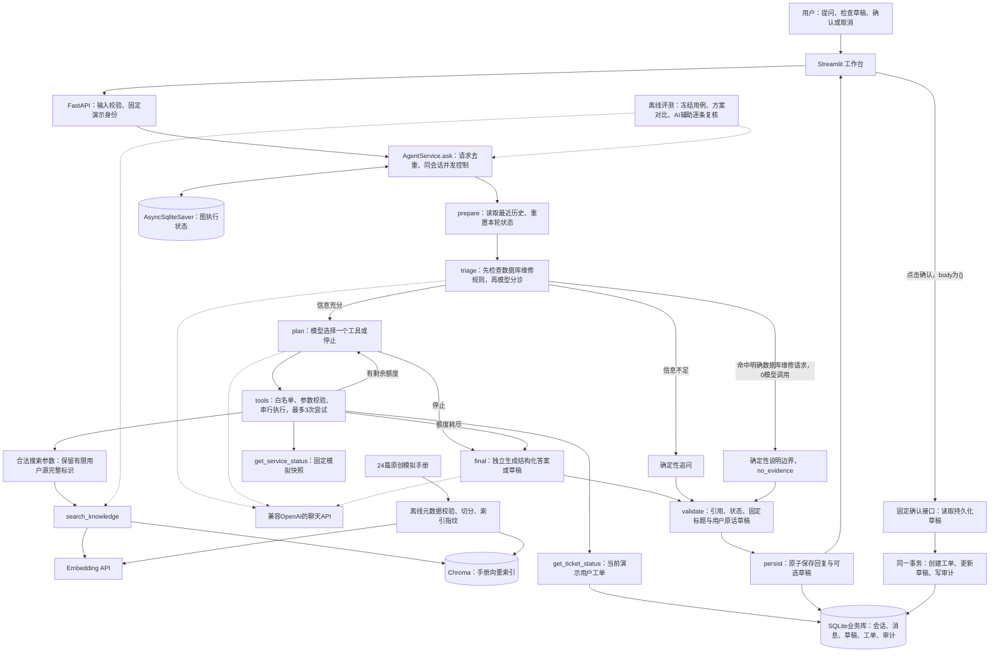

# ITDesk Copilot Lite：架构、源码与设计取舍

这是一个中等规模的本地 IT 服务台演示：员工描述问题，系统查询模拟手册、服务状态和工单，整理排查建议或待核查草稿；用户确认后才创建模拟工单。使用单个Agent、三个只读工具及本地存储，没有接入真实企业系统。本文的架构、技术九问、源码行号与评测说明以第四周核心设计快照为基准，包含查询保码、用户原话草稿和数据库维修边界。[第四周报告](week4-report.md)记录当时的非盲定向回归，[第三周报告](week3-report.md)保留旧实现的首轮结果。此后新增的前端优化、会话管理和草稿修改见[前端交付记录](frontend-delivery.md)，最新聊天布局与八项本地显示设置见[聊天界面与显示设置](chat-ui-settings.md)；现码不声明与第四周源码摘要完全相同，也未将历史模型成绩当作现版重跑结果。

## 1. 整体架构

| 模块 | 实际职责 | 不应归入它的能力 |
|---|---|---|
| `app/main.py` | 请求、固定演示身份、确认与取消入口；前端迭代另增会话管理和草稿修改 API | 固定演示身份不能称为登录、SSO或RBAC。 |
| `ui/app.py`、`ui/workbench.py`、`ui/styles.py`、`ui/enhancements.js` | 薄入口、中文工作台交互、视觉/响应式主题、本地字数与无障碍增强 | 前端外观和调试开关不增加生产认证或真实企业处理能力。 |
| `app/agent.py` | 状态图、分诊、有限工具循环、输出校验、指标与保存 | LangGraph调度并非自研模型推理框架。 |
| `app/guardrails.py` | 有限用户源标识保留、数据库维修请求边界、原话草稿及有限凭证遮蔽 | 规则不是通用安全分类器；原话归因不是事实核验，也不是完整PII检测。 |
| `app/providers.py` | 分离聊天与Embedding配置，适配工具调用和JSON生成，脱敏上游错误 | 模型服务本身的训练和推理能力不属于项目实现。 |
| `app/retrieval/ingestion.py`、`store.py` | 原创文档接入、稳定片段ID、错误码与向量检索、索引一致性 | 没有通用全文搜索引擎、RRF或重排模型。 |
| `app/tools.py` | 三种只读工具、严格参数Schema、模拟状态与所有者过滤 | 不提供任意SQL、Python执行、网络请求或工单写入工具。 |
| `app/business.py` | 会话、消息、草稿、工单、审计、请求重放与确认事务 | 不执行真实企业派单、设备修复、关闭工单或权限开通。 |
| `evaluation`、`tests` | 开发/验收/定向回归分开、模型与规则子集统计、来源复核、故障注入 | 字符串risk_signals不判语义安全；AI评分不是独立人评，非盲回归不是新验收。 |

模型上下文只使用最近8条历史消息，每条最多2500字符。完整历史在业务库中保留；状态事实需本轮查询。Checkpoint记录图状态，业务表决定回复是否完成、草稿是否确认、工单是否存在。两库没有跨库事务，业务提交后Checkpoint失败时优先返回已提交结果。当前不承诺从任意中断节点自动续跑。

## 2. 端到端执行链路

示例问题：`VPN-403 设备未授权，怎么排查？`。以下是第四周核心链路契约；该周真实执行中的查询词、次数、时延与结果，以[第四周报告](week4-report.md)的原始trace为准；[第三周报告](week3-report.md)保留历史实现的结果。

| 环节 | 关键输入 | 模块处理与关键输出 |
|---|---|---|
| 建会话 | `POST /api/sessions`，`{}` | API固定注入演示用户，返回`session_id`。客户端不能指定身份。 |
| 接收消息 | `POST /api/sessions/{id}/messages`，`{"text":"VPN-403 设备未授权，怎么排查？","request_id":"demo-vpn-0001"}` | 校验长度/字段，请求去重，同会话只允许一条处理中请求；先保存用户消息。 |
| 分诊 | 当前问题、最近历史 | 先用`requires_database_change`检查明确的数据库维修动作，命中则不调用模型，直接输出边界说明并进入校验/保存。其他请求由`agent_triage`返回分类、意图、优先级建议及缺失信息；信息不足直接追问。 |
| 工具决策 | 对话与三个工具的Schema | 模型选择下一只读工具，Provider设置`parallel_tool_calls=False`；后端仍独立控制额度、批次与参数，不信任供应商一定遵守。 |
| 搜索参数归因 | 模型`requested_args`、本轮用户问题、有限最近用户历史 | 参数合法后保留当前用户完整标识；本轮无码且有明确追问词时才参考最近一条用户消息。不从助手历史或手册借码。轨迹`args`为实际执行参数，`requested_args`保留模型申请；新用户码优先，非法额外字段仍拒绝。 |
| 检索 | 有效query、索引指纹、Embedding模型 | 问题转向量；完整错误码精确命中置顶，补同文档相邻片段，再以cosine阈值过滤的向量结果去重补足Top5。返回片段原文、ID、标题、来源、版本和用量。 |
| 循环或停止 | 成功/失败的结构化工具结果 | 工具结果成为`ToolMessage`。最多3次尝试；错误参数也计数，多工具批次不执行。信息足够可提前停止。 |
| 最终生成 | 当前问题、历史、本轮片段与工具轨迹 | 独立聊天请求返回`answer/citation_ids/evidence_sufficient/ticket_draft`；不绑定写工具。JSON或引用错误最多修复一次。 |
| 后端校验 | 模型结果、本轮引用集合、用户原话 | 引用必须属于本轮；无知识片段或成功状态事实时使用拒答。若模型提议草稿，`sourced_ticket`以固定类别标题和用户原话形成持久化描述，回复使用确定性的待核查说明。模型类别及是否需要草稿仍可能错。 |
| 保存与返回 | 已校验结果、可选草稿 | `finish_turn`原子保存回复、草稿与草稿审计。API返回状态、分类、答案、引用、工具轨迹和用量；页面展开原文。 |

需要人工处理时，用户可接着说`排查后还是失败，请准备一张人工工单草稿`。模型仍通过`ticket_draft`提议及选择category；其自由改写的title/description不作为用户事实保存。后端生成类别固定标题，将当前用户原话和最多最近两条用户消息分别标明“未经独立核实”“仅上下文”，不取助手历史补事实；超长原话明确截断，有限凭证标签/常见Token做遮蔽。此时仅有pending草稿，没有新工单。页面确认调用`POST /api/drafts/{id}/confirm`且body为`{}`，一个事务创建工单、更新草稿和写审计。重复确认读取既有工单，取消后的草稿返回冲突。原话保留不证明用户所说真实，有限遮蔽也不等于完整脱敏。

## 3. 技术九问一：有状态编排与受限工具循环

源码：`app/agent.py::AgentService`（54）、`_triage`（151）、`_plan`（179）、`_tools`（221）、`ask`（414）；`app/guardrails.py::requires_database_change`（22）；`app/providers.py::OpenAIProvider.agent_step`（182）；`app/tools.py::ToolExecutor.execute`（66）。按符号定位，并与第四周源码摘要核对。

1. **为什么用？** 一个自然语言请求可能需要手册、服务状态、工单中的不同来源，下一步取决于前一步事实。分诊识别必要缺失信息，模型在有限工具间选择下一步；状态图表达澄清、循环、停止、失败和保存，解决上下文及分支管理问题。
2. **不用行不行？最简单方案？** 可以。一个普通函数按错误码、服务名、工单号路由，查询后生成回答即可覆盖大量请求。固定FAQ或固定顺序任务更适合普通Workflow，不需要Agent。
3. **替代方案？** 关键词规则、一次模型分类后固定Workflow、自己实现状态机、自由ReAct循环、多Agent、人工逐项查询。本项目没有需要Celery或Temporal的跨小时后台业务。
4. **为什么选择当前方案？** 成本：规则更便宜，本方案增加分诊/决策Token，以3次上限限制工具消耗；效果：可解释追问和多源选择，但模型仍会错分，不能先验宣称优于规则；延迟：串行增加等待，适合存在前后依赖的小闭环；稳定性：硬上限与明确终态防止无限循环；可控性：白名单、Schema、图条件边由代码决定；安全：模型无写能力，身份由服务端注入，但Prompt不保证免疫注入；维护：一张图、三个工具适合个人掌握，代价是图、业务表和Checkpoint需保持分责。选它是可验证的有限决策练习，而非“Agent一定更好”。
5. **架构位置、输入输出、依赖和调用链？** 应用编排层，输入当前问题和最近历史，依赖Provider、ToolExecutor、业务库、AsyncSqliteSaver。正常链为`prepare → triage → plan ⇄ tools → final → validate → persist`；需要澄清或命中数据库维修规则时跳过工具和最终生成，后者连模型分诊也不调用。
6. **在Agent中扮演什么角色？** 模型分诊与工具选择是有限决策；图调度、计数、并发保护、Checkpoint、数据库和维修规则均是普通代码。规则分支不能计成模型分类成绩；Checkpoint不是长期记忆检索，也不是工单业务真相。
7. **业务价值与指标，证据在哪？** 用户可在一个入口完成不同查询并追踪来源。测类别/意图Macro-F1、必要追问、工具选择、任务状态、调用次数、P50/P95、Token与恢复，模型和规则分母分开。第三周为历史基线，当前定向回归见第四周报告；没有真实员工解决率、日活、节省工时或生产SLA数据。
8. **替换或移除后的变化及依据？** 改规则路由能减少模型调用与延迟，也可能增加同义表达、多轮指代维护量；去掉上限可支持更长任务，也会扩大重复查询成本。上限变化由控制流可确定；准确率或维护成本变化需另做同集对照，不能拿检索对比冒充Agent对规则的效果对比。移除Checkpoint仍可从业务表恢复完成历史，但失去中间节点诊断。
9. **怎样失败？** 分诊JSON/枚举错误最多修复一次；缺关键信息返回`needs_info`。非法工具名、参数、JSON、多工具批次都计额度；即使请求禁止并行，后端仍拒绝整批。维修规则是有限词匹配，可能漏判/误判，不能当通用安全审核；系统无SQL执行工具。工具10秒、整轮90秒，上游默认20秒和SDK最多一次瞬时重试。达到3次强制最终阶段，图失败尽力保存响应与轨迹；已完成ID重放，中断请求用新ID重提。同会话保护只限单进程，人工兜底需用户联系正式IT。

## 4. 技术九问二：向量检索与错误码精确匹配

源码：`app/retrieval/ingestion.py::extract_error_codes`（15）、`chunk_documents`（49）；`app/retrieval/store.py::KnowledgeStore._current`（23）、`build_index`（87）、`retrieve`（137）；`app/guardrails.py::grounded_search_args`（35）；检索对比实现与冻结集见`evaluation`。

1. **为什么用？** 用户可能只描述“连内网时一直验证失败”，也可能给出`VPN-403`。向量处理同义表达；精确标识符区分相近故障码，相邻片段补齐验证和人工升级。第三周D008还暴露了上游查询改写丢码：因此在搜索执行前保留有限用户源完整标识，避免检索器有精确规则却收不到码。
2. **不用行不行？最简单方案？** 24篇小手册可直接按错误码字典查找，或者用关键词搜索。没有语义改写需求时，错误码字典可能更低成本；只有自然语言FAQ时可先纯向量。
3. **替代方案？** SQLite FTS/BM25、纯向量、纯错误码规则、PostgreSQL全文与pgvector、Elasticsearch、Cross-Encoder重排、人工维护FAQ。当前不把简单置顶称为RRF混合检索或学习排序。
4. **为什么选择当前方案？** 成本：复用一个Embedding和本地Chroma，无额外重排调用；效果：精确码有确定性匹配，改写靠向量，实际收益/退化必须看同集实验；延迟：需要在线Embedding，相比字典慢；稳定性：无效向量和旧索引被拒绝，但仍依赖外部Embedding可用；可控性：完整码边界、Top5、阈值、来源可读；安全：资料作为数据，禁止把手册文本当授权，检索本身不能消除恶意文档；维护：比部署搜索集群轻，代价是错误码元数据和指纹需维护。小数据下未证明需要额外数据库或重排模型。
5. **架构位置、输入输出、依赖和调用链？** `AgentService._tools → grounded_search_args → ToolExecutor.execute → retrieve → embed_query + Chroma.query`。参数合法后，用当前用户完整标识替换模型query中的标识；本轮无码且含追问词时才看最近一条用户消息，2000字符内保留标识。`requested_args`记录模型请求，`args`记录执行值。检索输出原文、ID、来源、版本、距离/精确标记；离线按加载、切分、Embedding建立索引。
6. **在Agent中扮演什么角色？** 外部知识来源，不是规划核心。Embedding模型负责相似度表示；错误码匹配、排序组合、去重和来源保留是普通代码。
7. **业务价值与指标，证据在哪？** 目标是减少相近故障混淆，让用户核查原文。测用户码在实际query中的保留、文档Recall@5、关键段落覆盖、错误拒答、时延和Embedding用量。第三周同查询对比未测出组合策略收益，不能改写历史结论；第四周用D008重放和改写验证执行边界，结果见本周报告。命中文档不等于关键段落完整或答案正确。
8. **替换或移除后的变化及依据？** 去掉精确匹配可能影响错误码排名，去掉向量可能漏同义表达；具体幅度由消融实验决定。精确码及邻片段占用Top5位置，也可能挤掉另一篇所需文档，必须报告退化。数据量增长后可以再评估FTS/重排，当前不预设复杂方案一定值得。
9. **怎样失败？** 标识保留只能处理既定格式，不代表知道码的语义；用户给错码仍可能检索错误。新问题有新码时不借旧码，非法参数不经修正洗成合法调用。空结果不编造排障；指纹变化需显式重建，新集合成功后才切换清单。完整边界使VPN-403不匹配VPN-4030，向量数量/维度/有限非零值均校验。Chroma/Embedding失败以结构化错误返回，默认0.50阈值不是通用质量保证。

## 5. 技术九问三：结构化输出与本轮引用校验

源码：`app/schemas.py::Triage`（141）、`AgentFinal`（121）、`TicketProposal`（107）；`app/providers.py::agent_triage`（142）、`agent_step`（182）、`agent_final`（192）；`app/agent.py::_final`（296）、`_validate`（334）；`evaluation/metrics.py::live_contract`。

1. **为什么用？** 工具协议消息、页面业务字段和数据库记录需要不同契约。分开调用工具决策与最终JSON生成，后端才能稳定识别追问、拒答、答案和草稿，并拦截虚构引用ID。
2. **不用行不行？最简单方案？** 直接显示工具循环最后的自由文本可以少一次调用，但很难可靠抽取草稿字段、状态和引用。只显示原始检索结果则可以完全省去自然语言生成。
3. **替代方案？** 服务商原生JSON Schema约束、特殊“返回答案”工具、正则抽取、第二个LLM Reviewer、人工逐条审阅。不同兼容端点能力不同，当前用JSON提示与Pydantic，而非假定原生约束解码普遍可用。
4. **为什么选择当前方案？** 成本：正常增加最终生成，格式失败最多额外一次，在线Reviewer更贵；效果：格式/引用集合确定可校验，语义支持仍需复核；延迟：本地校验轻，模型网络调用占主要时间；稳定性：避免强制工具调用与专有结构化协议耦合，模型仍可能不遵守JSON；可控性：业务Schema拒绝额外权限字段，引用由实际片段构造；安全：模型文本不能授权写操作，但恶意资料仍可能影响文字；维护：明确Provider方法便于替换和测试，需同步提示词、Schema和页面契约。收益是可消费的业务协议，不是对模型正确性的全面保证。
5. **架构位置、输入输出、依赖和调用链？** Provider适配层与编排输出边界。分诊输入问题/历史，输出Triage；工具选择输出AIMessage；最终输入本轮证据/工具轨迹，输出AgentFinal。`_final`核对引用集合，`_validate`决定状态和展示内容，随后持久化。
6. **在Agent中扮演什么角色？** 这是输出协议和防护层。知识/状态答案仍由模型组织语言；待确认草稿和维修边界回复采用普通代码。Pydantic不会理解业务语义，引用存在检查也不承担身份、授权或事实审阅。
7. **业务价值与指标，证据在哪？** 页面和调用方能区分状态，用户可展开本轮原文。测JSON通过率、修复、非法引用拦截、引用ID、拒答与来源支持。第四周字符串命中只列risk_signals和semantic_review_required，不因否定句含短语就判危险，也不能把机械通过称安全通过。按用户选择逐条AI对照来源，真人评分仍未验证；新机械规则通过率不能与旧规则直接相减当质量提升。
8. **替换或移除后的变化及依据？** 去掉引用集合校验允许不存在的ID进入页面；改自由文本可能减少调用与时延，但增加解析失败。原生JSON约束可能降低格式错误，但需实测供应商；额外Reviewer可能发现语义错配，也会误判且增加成本。本项目的AI辅助离线复核不属于在线Agent Reviewer。
9. **怎样失败？** 非法JSON、字段/枚举/引用错误最多修复一次，仍不合规则失败，未经验证的模型原文不直接放行。模型称证据不足，或本轮没有可用事实时使用标准拒答；状态类可只用成功状态工具回答。混合回答中的知识句未必逐句得到支持，必须在离线复核中检查；不能把有效引用率当证据支持率。Provider认证、限流、超时等错误脱敏；失败API可能有未返回用量，费用保持未知。

## 6. 技术九问四：用户确认、事务与幂等工单

源码：`app/guardrails.py::sourced_ticket`（66）、`redact_report`（55）；`app/agent.py::_validate`（334）；`app/business.py::finish_turn`（256）、`confirm_draft`（312）、`cancel_draft`（341）、`get_ticket`（363）；`app/schemas.py::EmptyRequest`（137）；`app/main.py::create_app.confirm`（124）、`cancel`（129）；`ui/app.py::render_drafts`（326）。

1. **为什么用？** “报修”“确认”可能含糊，第三周也实际出现补写经历和把故障码当设备编号的草稿错误。后端改用固定标题和用户原话，明确归因及未知边界，再让用户检查；确认接口和事务处理误建、双击、重发与中途失败。原话不等于已核实事实。
2. **不用行不行？最简单方案？** 普通工单表单即可解决建单，且更可控。AI只是可选的信息归纳入口；即使移除模型，确认、所有权、事务和幂等仍然需要。
3. **替代方案？** 给Agent写工具、识别聊天关键词后自动提交、客户端确认时重传可变字段、传统表单、完整审批引擎。当前用户确认不等于管理员批准，也不需要独立审批平台。
4. **为什么选择当前方案？** 成本：固定模板无额外Reviewer调用，但多一次用户核对；效果：后端不自由扩写经历，代价是描述较长、少了语言归纳，仍不能保证用户陈述或类别正确；延迟：模板和确认仅本地代码；稳定性：唯一draft_id和事务防半提交/重复单；可控性：原话分别归因，body为空、字段从存储读取；安全：模型无写工具，有限凭证遮蔽不覆盖全部PII；维护：小规则和三种状态适合个人掌握，但要测截断、错误类别、并发及回滚。固定身份不构成公网登录。
5. **架构位置、输入输出、依赖和调用链？** 模型提议是否需要草稿和category；`_validate → sourced_ticket`读取当前用户原话及最多最近两条用户上下文，固定标题并生成未核实描述，随后`finish_turn`原子保存。按钮`confirm → confirm_draft → BEGIN IMMEDIATE → 读草稿/所有者 → 插入工单 → 更新草稿 → 审计 → commit`。确认、取消不经过模型。
6. **在Agent中扮演什么角色？** 模型提出草稿及分类；原话描述、待确认答复、身份过滤与写入均属普通业务代码。SQLite事务和唯一约束来自数据库，有限凭证遮蔽是工程规则，不是模型理解或事实审核；当前没有企业权限系统。
7. **业务价值与指标，证据在哪？** 目标是少重复录入并防止误建、重复工单。测未确认创建次数、重复确认新增数、故障后不一致行数、越权泄漏及草稿事实一致性；用真实业务库和故障注入验证，而非只检查按钮是否出现。实测报告提供本地证据，没有真实企业采纳率、解决率或处理时长下降数据。
8. **替换或移除后的变化及依据？** 恢复自由改写能缩短描述，也重新引入D015/A033所示事实归纳风险；只加强Prompt无法保证消除。直接建单少一次点击，但误意图落库；关键词确认可误读示例或注入，确认时可换字段会使所见与提交不一致。去掉事务会留下中间态。原话测试、并发确认和SQL失败回滚验证已测机制，不代表所有攻击均被覆盖。
9. **怎样失败？** 用户输入可能错误/敏感，过长原话会明确截断，历史仅作上下文，类别和草稿提议仍可能错；有限遮蔽不保证脱敏。外人/不存在记录统一不可见，额外确认字段422、取消后确认409；重复确认同一编号。`finish_turn`失败回滚回复/草稿/审计，`confirm_draft`失败回滚确认事务，两路径分别测试。Checkpoint不是创建事实，日志只记错误类型，真实处理须人联系正式渠道。

## 7. 业务五问

1. **为什么做，谁用、频率与痛点？** 假想使用者是员工与IT服务台，痛点是假设中的手册分散、状态页/工单页切换、升级人工时重复描述。项目证明这些动作可形成一个闭环，没有企业访谈、真实日请求量或用户留存证据；不能把模拟频率写成业务事实。
2. **为什么需要AI？** 模型用于自然语言理解、追问、有限工具选择、组织证据及判断是否提议草稿/类别；Embedding用于语义召回。当前草稿事实采用后端用户原话，数据库维修边界也用规则。参数、身份、额度、状态、事务及确认均适合普通代码。标准FAQ/表单可用Workflow，不能因为用了模型就预设有业务收益。
3. **如何判断成功，数据在哪？** 工程指标验证四条链路、保码、原话归因、确认和回滚；质量看分类、召回、引用、拒答与AI来源支持；体验/成本看时延、恢复工具超时、Token及已配置价格。第三周历史和第四周非盲回归分开；第四周12个图请求中11模型、1规则，另1个历史轮次，规则成绩不能混充模型质量。risk_signals不能判安全，真人支持率未验证，实际证据见两周各自报告。
4. **系统边界与责任？** 模型读取模拟知识/状态/工单，只能提出草稿；用户按钮确认后后端写本机工单。真实授权、派单、关闭工单、修复设备和企业审批由人及正式系统负责。状态是固定模拟快照；本机明文数据与固定身份不适用于生产敏感资料。失败不当作事实，引用存在不当作语义正确。
5. **剥离团队后，本人到底做了什么？** 本项目由AI辅助实现和验证。可说明自己掌握并能复现的范围：业务边界、状态图、工具契约、检索组合、输出校验、会话幂等、确认事务、评测与页面；不能直接声称所有代码均本人手写。LangGraph调度/Checkpoint、Chroma向量库、Pydantic、SQLite事务、SDK和模型都是已有能力。真实多人协作需另提供本人负责模块与提交证据，当前没有企业团队履历或上线证据。

## 8. 源码核对方式

以上行号对应第四周核心设计快照，完整符号位置见[第四周源码索引](evidence/week4-source-map.json)，摘要见[第四周SHA-256](evidence/week4-source-sha256.json)。这些文件与第三周索引/trace均作为历史证据保留；前端迭代后的现码不声明与第三/四周摘要完全相同。第四周快照的`ui/app.py`承载页面实现，现版已拆为薄入口`ui/app.py`与`ui/workbench.py`等模块；会话管理、草稿修改与敏感输入规则也有后续变更。最新源码范围、170项自动化测试及前端验证见[前端交付记录](frontend-delivery.md)与[现版源码摘要](evidence/frontend-source-sha256.json)。阅读历史trace时仍按第四周的12题非盲回归解释模型/规则分母和AI评分，不将其套用于现版。

| 技术点 | 实际源码入口 |
|---|---|
| 状态编排、有限决策 | [AgentService](../app/agent.py)、[有限业务边界](../app/guardrails.py)、[ToolExecutor](../app/tools.py)、[生命周期与Checkpoint](../app/main.py) |
| 向量与完整错误码 | [用户源标识保留](../app/guardrails.py)、[文档与错误码处理](../app/retrieval/ingestion.py)、[KnowledgeStore](../app/retrieval/store.py)、[同查询对比](../evaluation/run.py) |
| 结构与引用校验 | [Schema](../app/schemas.py)、[Provider](../app/providers.py)、[最终生成与校验](../app/agent.py) |
| 确认、事务与幂等 | [业务存储](../app/business.py)、[固定确认接口](../app/main.py)、[事务回滚和并发测试](../tests/test_business.py) |
