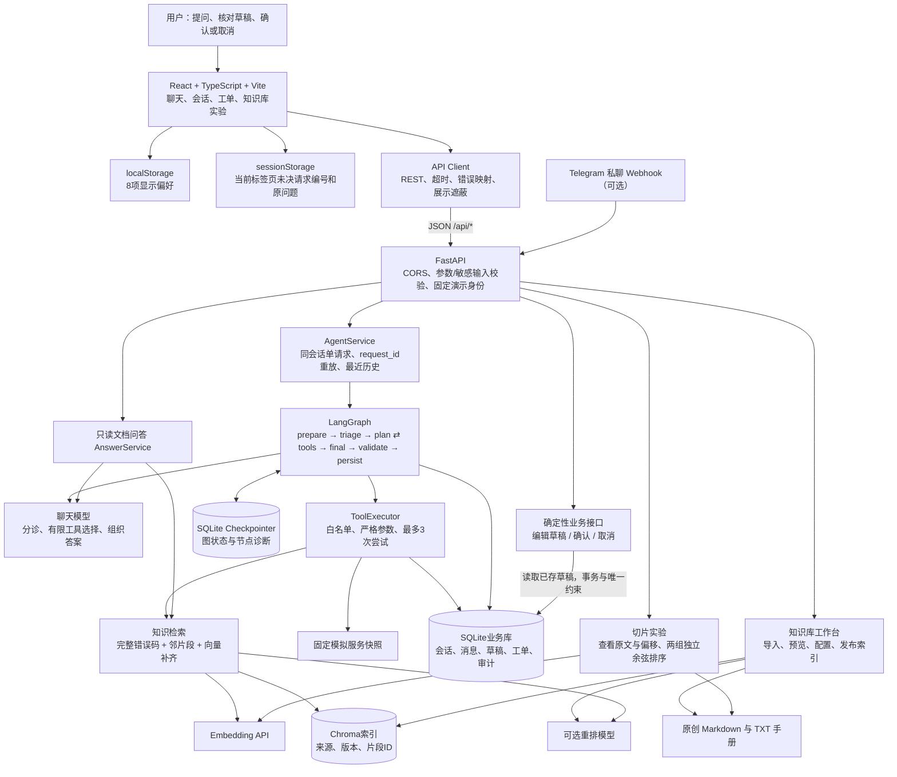

# ITDesk Copilot：React 前后端分离设计与源码研究

React、TypeScript、Vite 承担浏览器交互，FastAPI 通过 HTTP 提供单 Agent、三个只读工具、知识实验和工单业务。Chroma 存问答索引，SQLite 存业务和执行状态。演示使用本机固定身份、虚构资料和模拟工单。[原型退役记录](streamlit-retirement.md)

字段和错误协议见 [API 契约](react-api-contract.md)，本地启动见 [README](../README.md)。React 迁移、第三和第四周模型评测属于历史快照。知识库实验和机器人协议的最新口径见[本轮验收](knowledge-lab.md)。

## 1. 整体架构：模块、职责与协作

React 负责展示、输入和交互状态；API/业务库才决定草稿与工单的实际状态。模型只能读取三个白名单工具和提议草稿。确认接口不经过模型，Checkpoint 也不作为“工单已经创建”的依据。CORS 控制浏览器跨域读取和预检许可，不能代替身份认证；固定 `DEMO_USER_ID` 不构成真实登录或 RBAC。

## 2. 一条端到端链路：排查后升级为模拟工单

示例输入：“VPN-403 按手册检查后仍失败，请准备工单交人工核对，先不要提交。”

| 步骤 | 经过模块 | 关键输入 | 关键输出与责任 |
|---|---|---|---|
| 1. 输入 | React 聊天页 → API Client | 1–2000 字问题、当前会话；新请求编号 | 先展示 pending；推荐问题只预填。请求编号和原问题用于恢复，尚无新工单。 |
| 2. HTTP 边界 | `POST /api/sessions/{id}/messages` → `MessageRequest` | `{question, request_id}`；不接受用户身份、工单状态等额外字段 | 后端校验输入并注入演示身份；返回 422/404/409 等明确错误，不能由页面绕过。 |
| 3. 恢复与去重 | `AgentService.ask` → `BusinessStore.get_session/get_request` | 会话编号、演示用户、请求编号 | 已完成的相同请求返回持久化结果；同编号换问题拒绝；同会话并发拒绝；中断且无完成结果的旧请求要求新编号。 |
| 4. 分诊与有限决策 | `prepare → triage → plan ⇄ tools` | 最近用户/助手历史、当前问题、工具 Schema | 分类/缺失字段、一个工具调用或停止；缺信息则追问。最多三次工具尝试，非法调用也消耗额度。 |
| 5. 获得事实 | `grounded_search_args → ToolExecutor.execute → KnowledgeStore.retrieve` | 合法检索参数、有限用户源完整错误码 | 返回片段 ID、原文、来源、版本；当前例可查询 VPN-403 手册，服务/工单来源按实际工具选择获取。 |
| 6. 形成结果 | `final → validate → persist` | 本轮证据、工具轨迹、结构化输出 | 校验本轮引用；可形成 `pending_confirmation` 草稿。持久化描述采用归因明确的用户原话，不把模型补写经历当事实。 |
| 7. 页面返回 | API Client → 消息/引用/工具/草稿组件 | `answer/status/citations/tool_trace/metrics/draft` | 展示回答及可核查来源；`failed` 与 `no_evidence` 不伪装成功。HTTP 200 也可能是业务失败。 |
| 8. 人工核对 | 草稿组件 → `PATCH /api/drafts/{id}` | 用户修改的标题、描述、分类 | 更新已存草稿，状态仍为 pending；编辑不等于创建。 |
| 9. 明确确认 | 按钮 → `POST /api/drafts/{id}/confirm` → `confirm_draft` | 草稿编号，body 仅 `{}` | 事务读取已存草稿，创建模拟工单、更新状态和写审计；重复确认返回同一工单。 |

取消会使草稿进入 cancelled；取消后不能确认。网络超时只说明浏览器未收到确定结果，不能推断服务端已停止、工单未创建或草稿已取消。页面应先刷新持久化记录，再按错误码决定重试或重新发起。

## 3. 五个真正存在的技术取舍与源码位置

以下按符号定位，避免前后端迁移期间行号变化。当前代码和测试可直接打开；历史源码行号仍只对应历史快照。

| 技术点 | 主要源码位置 | 验证入口 |
|---|---|---|
| React 与 REST API 分层、类型和跨域边界 | [`fetchJson`、`api`](../frontend/src/api/client.ts)；[`ApiError/responseError`](../frontend/src/api/errors.ts)；[前端类型](../frontend/src/api/types.ts)；[`Settings.explicit_origins`](../app/config.py)；[`create_app`](../app/main.py) | [API Client 测试](../frontend/tests/api-client.test.ts)、[CORS 测试](../tests/test_cors.py) |
| 单 Agent 与受限工具循环 | [`AgentService`](../app/agent.py)：`_triage/_plan/_tools/_validate/ask`；[`ToolExecutor.execute`](../app/tools.py) | [Agent 测试](../tests/test_agent.py)、[边界回归](../tests/test_week4_agent.py) |
| 错误码与向量召回、来源和引用校验 | [`KnowledgeStore.retrieve/build_index`](../app/retrieval/store.py)；[`extract_error_codes/chunk_documents`](../app/retrieval/ingestion.py)；[`grounded_search_args`](../app/guardrails.py)；[`AgentService._final/_validate`](../app/agent.py) | [检索测试](../tests/test_store.py)、[历史检索/质量报告](week3-report.md) |
| 请求幂等、草稿核对与事务确认 | [`App.execute/retry/refreshSession`](../frontend/src/app/App.tsx)；[`loadPending/savePending`](../frontend/src/features/chat/pending.ts)；[`DraftCard`](../frontend/src/features/drafts/DraftList.tsx)；[`AgentService.ask`](../app/agent.py)；[`BusinessStore.get_request/finish_turn/confirm_draft`](../app/business.py) | [请求暂存测试](../frontend/tests/pending.test.ts)、[草稿浏览器测试](../frontend/tests/e2e/drafts.spec.ts)、[会话 API 测试](../tests/test_week2_api.py)、[编辑/删除/确认测试](../tests/test_frontend_business.py)、[业务事务测试](../tests/test_business.py) |
| 自然边界与固定窗口的切片对照 | [`iter_chunk_spans`](../app/retrieval/ingestion.py)、[`KnowledgeLab.prepare_comparison/compare`](../app/retrieval/lab.py)、[React 知识库页](../frontend/src/features/knowledge/KnowledgePage.tsx)、[离线评测](../evaluation/chunk_experiment.py) | [后端测试](../tests/test_knowledge_lab.py)、[浏览器测试](../frontend/tests/e2e/knowledge.spec.ts)、[实验报告](knowledge-lab.md) |

工作台新增的索引发布链路从文档和检索配置开始，经 `KnowledgeWorkspace.apply` 建立独立版本，检查索引后才切换当前指针。召回测试和聊天都读取当前版本。`KnowledgeStore.retrieve` 先按余弦相似度召回，可选 Rerank 对候选重排。精确码及其相邻证据保留优先级。改变 Embedding 需要重建索引，改变 Top K 或重排只影响查询阶段。测试覆盖失败时保留旧版本和重排回退。[工作台](../app/retrieval/workspace.py) · [模型注册](../app/retrieval/profile.py) · [检索](../app/retrieval/store.py) · [验收](knowledge-lab.md)

### 技术九问一：React、TypeScript 与 REST API 分层

1. **为什么用？** 聊天、会话管理、草稿编辑和设置具有相互独立的加载、失败和未保存状态。React 用组件和状态表达这些交互，API Client 集中处理 HTTP、超时与错误，TypeScript 提前发现已声明字段的误用；不再依赖 Streamlit 重跑整段页面和内部 DOM 选择器。
2. **不用行不行，最简单方案是什么？** 可以继续使用已有 Streamlit，它能以更少前端基础设施完成本机演示。当前迁移主要服务于可维护的浏览器交互与简历中的前后端工程训练，没有证据证明 React 会提升答案质量。
3. **替代方案有哪些？** Vue 3、普通 HTML/JavaScript、Streamlit，或 Next.js。Vue 可完成同样需求；固定简单表单可直接用普通页面；本机服务台不需要 SSR 才能完成四条业务链路。
4. **为什么选择当前方案？** 成本：新增 Node 依赖与独立构建；效果：组件分工和可测交互更清楚，不改变模型能力；延迟：REST 仍等待完整结果，没有流式收益；稳定性：类型和统一错误减少字段误用，但 `fetchJson<T>` 不是完整运行时 Schema 验证；可控性：服务端继续控制业务状态；安全：无凭证入前端，CORS 只提供浏览器 Origin 许可；维护：需要维护 Python/TypeScript 两套类型，换取前端组件与后端业务分离。暂不增加 SSR、SSE 或 WebSocket。
5. **架构在哪层，输入输出和依赖是什么？** 浏览器展示与 HTTP 适配层。组件调用 `api`，`fetchJson` 输入路径/body/超时，输出解析后的对象或 `ApiError`；后端 `create_app` 校验与执行。前端只配置 API base URL，模型地址和密钥留在 Python 后端。
6. **在 Agent 里扮演什么角色？** 它不属于 Agent 决策核心，负责把用户操作和服务端结果可靠呈现。CORS、TypeScript 和加载动画都不是模型推理、权限审批或任务完成的证明。
7. **业务价值和指标，证据是什么？** 用户可以在一个浏览器入口查看历史、引用并核对草稿。用构建/类型检查、API 错误测试、关键流程浏览器测试、桌面/手机布局核验来验证。没有真实员工采用率、工时节省或 React 对 Streamlit 的耗时对照，不能填写相应收益百分比。
8. **替换或移除会怎样，依据是什么？** 退回 Streamlit 可减少 Node 工程成本，也会回到其页面运行与组件约束；改 SSE 需要连接恢复、中断和事件协议，当前 REST 无此复杂度。准确率不会因换前端自动改善；界面开发成本变化应以实际迭代记录衡量。
9. **怎样失败，如何处理？** 客户端区分网络、超时、非 JSON 和 HTTP 错误；422 校验数组与业务错误对象不能混用。GET 默认 5 秒，写请求默认 100 秒；不自动反复发送写请求。不可信 Origin 预检失败或没有跨域读取许可，但这不是认证，非浏览器客户端仍可访问本机服务。API 返回对象的更深字段仍依赖契约与测试，缺失字段不能被当成成功事实。

### 技术九问二：单 Agent、有限决策与只读工具上限

1. **为什么用？** 同一类 IT 请求可能要查手册、服务快照或工单，下一步依赖已有事实和缺失信息。单 Agent 做有限来源选择，图表达追问、工具循环、最终生成、失败与保存，避免把状态全塞进一个提示词。
2. **不用行不行，最简单方案是什么？** 可以用错误码/服务名/工单号规则路由，或者一次模型分类后走固定 Workflow。纯 FAQ、固定查询表单不需要 Agent。
3. **替代方案有哪些？** 普通函数、规则 Workflow、自写状态机、自由 ReAct、多 Agent，或人工逐页查询。当前没有跨小时任务，不需要持久任务队列或复杂调度平台。
4. **为什么选择当前方案？** 成本：增加分诊与决策 Token，三次工具尝试限制开销；效果：支持有限多源选择，但未做同集 Agent 对规则的效果实验；延迟：串行模型/工具增加等待；稳定性：硬上限、严格参数和终态可限制循环；可控性：图边、白名单和计数属于代码；安全：模型无工单写工具，Prompt 仍不保证免疫注入；维护：一张图和三个工具适合个人掌握，代价是同时维护图状态、业务记录与诊断 Checkpoint。
5. **架构在哪层，输入输出和依赖是什么？** `AgentService.ask` 接收问题、身份、会话和请求编号，读取最近历史，执行 `prepare → triage → plan ⇄ tools → final → validate → persist`。Provider、ToolExecutor、业务库与 AsyncSqliteSaver 是依赖；输出明确业务状态、回答、证据、轨迹、用量和可选草稿。
6. **在 Agent 里扮演什么角色？** 分诊和选择下一个只读工具属于有限决策；调用计数、参数校验、维修边界规则、身份注入和数据库属于确定性工程。命中数据库维修边界的规则回复不应计成模型分类成功。
7. **业务价值和指标，证据是什么？** 目标是减少不同来源页面之间的切换并保留过程。测类别/意图、工具选择、必要追问、调用次数、任务状态、时延和 Token。已有 [第三周](week3-report.md) 与 [第四周](week4-report.md) 记录分别对应历史实现；React 迁移没有产生新的模型质量成绩。
8. **替换或移除会怎样，依据是什么？** 改固定规则可能更便宜、更快，但同义表达与多轮指代规则更多；没有实验不能量化效果差异。移除工具上限会扩大重复调用风险，这是控制流可确定的变化；改多 Agent 还会增加上下文、调用次数和调试复杂度，当前没有业务证据支持该投入。
9. **怎样失败，如何处理？** 分诊/最终格式失败最多修复一次；缺信息返回追问；未知工具、非法参数和多工具批次均消耗尝试额度，禁止批次不执行。工具默认 10 秒、整轮 90 秒，上游错误以脱敏结构返回，失败尽力保存轨迹。`_busy` 仅适用于单进程，不提供跨 worker 锁；人工兜底是用户联系正式 IT，不会自动派给真人。

### 技术九问三：错误码、向量检索与本轮引用校验

1. **为什么用？** “反复验证失败”需要语义召回，`VPN-403` 等标识又要求区分完整错误码。精确片段及同文档邻片段优先，向量补齐剩余候选；返回原文/版本/ID，使用户可以核查生成依据。
2. **不用行不行，最简单方案是什么？** 对 24 篇小手册，错误码字典或关键词检索即可起步。只展示原始手册也能完全省去答案生成，代价是用户自行筛选和阅读。
3. **替代方案有哪些？** 纯向量、纯错误码规则、SQLite FTS/BM25、PostgreSQL pgvector、搜索集群、重排模型或人工维护 FAQ。当前组合是确定性置顶、邻片段和去重，不是 RRF 或学习排序。
4. **为什么选择当前方案？** 成本：本地 Chroma 加一次在线 Embedding，不增加重排模型；效果：完整码可确定匹配，语义收益要看同集对照；延迟：比字典多 Embedding 网络开销；稳定性：索引指纹和向量校验拒绝旧/坏索引，仍依赖服务可用；可控性：Top5、完整码边界、阈值和来源明确；安全：资料作为数据，引用集合检查不等于防注入或事实审核；维护：比搜索集群轻，但需维护元数据、切分与指纹。
5. **架构在哪层，输入输出和依赖是什么？** 工具/检索层接收合法 query，经 `grounded_search_args` 保留有限用户源标识，再由 `retrieve` 调用 Embedding 与 Chroma。输出含片段、来源、版本、ID和匹配标记；`_final/_validate` 仅允许从本轮实际证据构造引用。
6. **在 Agent 里扮演什么角色？** 它是外部知识来源和输出依据校验，不负责决定任务权限。Embedding 负责表示，标识保留、排序、去重和引用集合属于普通代码；引用有效不能证明整段答案语义受支持。
7. **业务价值和指标，证据是什么？** 测完整码保留、Recall@5、关键段落覆盖、无证据拒答、引用ID有效性、逐条来源支持、Embedding时延和用量。第三周同查询实验未发现组合策略的召回提升，该结论继续保留；不能因迁移前端或看见引用就宣称答案正确率提升。来源支持评分仍明确为 AI 辅助复核，独立真人评分未验证。
8. **替换或移除会怎样，依据是什么？** 去向量可能漏同义表达，去精确码可能改变相近码排名；幅度只能由同集消融验证。精确片段及邻片段会占用Top5，也可能挤掉其他相关文档，需要同时记录退化；增加重排有额外成本，当前数据不证明必须使用它。
9. **怎样失败，如何处理？** 空结果不编排障；资料/模型变化后的旧索引拒绝查询，显式重建成功后才切换。完整边界避免VPN-403误匹配VPN-4030；非法工具参数不能经保码修正洗为合法。Embedding超时、维度/数量/有限值异常与Chroma故障返回结构化错误。用户给错码、恶意手册和语义误解仍可能失败，需逐条复核与人工核查。

### 技术九问四：请求编号、持久化草稿和事务确认

1. **为什么用？** 浏览器超时并不代表服务端没完成；双击、刷新和重试可能重复调用模型或创建工单。请求编号把一轮消息与结果绑定，持久化草稿让用户先检查，唯一约束和事务使确认具有可重复读取的结果。
2. **不用行不行，最简单方案是什么？** 普通工单表单就能创建工单，模型并非必需；但即使去掉模型，确认、重复提交与事务仍然需要。仅禁用按钮不能防断网重发或多窗口请求。
3. **替代方案有哪些？** Agent直接调用写工具、聊天关键词自动确认、前端确认时重新提交可变字段、传统表单、外部幂等存储/分布式锁或审批系统。当前本机单进程规模不需要分布式平台。
4. **为什么选择当前方案？** 成本：本地状态/SQLite读写，不增加模型调用；效果：避免已完成请求重复执行与同草稿重复建单，不验证用户事实；延迟：增加很短的持久化临界区，模型调用期间不持有确认事务；稳定性：业务记录与唯一约束是事实来源；可控性：确认body仅空对象、字段从已存草稿读取；安全：后端注入身份与所有者过滤，模型无写权，但固定身份不是生产认证；维护：需要覆盖pending/confirmed/cancelled及网络不确定态，换取明确可核查的结果。
5. **架构在哪层，输入输出和依赖是什么？** 前端 `pending.ts` 将当前标签页未决请求写入sessionStorage；`ask/get_request/finish_turn` 处理请求重放和回复/草稿保存。`DraftCard` 显示或编辑已存字段；`confirm_draft` 在一个事务中检查所有者/状态，写工单、草稿和审计，再返回工单编号。
6. **在 Agent 里扮演什么角色？** 模型只提议草稿与类别；`sourced_ticket` 用固定标题和归因明确的用户原话生成持久化描述，编辑/确认/取消均是业务代码。SQLite事务、唯一索引与sessionStorage来自基座能力，不属于模型推理。
7. **业务价值和指标，证据是什么？** 重点测未确认建单次数、同请求重复模型调用、同草稿重复工单、故障后的半提交、外部记录泄露与恢复后的状态一致性。API、业务事务和故障注入测试提供本地证据；没有真实报修采纳率、处理时长下降或企业事故数据。
8. **替换或移除会怎样，依据是什么？** 去请求重放可能重付模型费用；去事务可能留下工单已插入但草稿未更新的中间态；改聊天确认可能误读样例和含糊表达。事务与幂等测试能验证这些机制，不能证明所有生产故障。自由改写草稿可缩短文字，却会重新引入历史事实混淆风险，见第四周的原话修复说明。
9. **怎样失败，如何处理？** 已完成的同编号同问题重放；同编号换问题409；会话busy先等待；已存用户消息却无完成结果返回`request_interrupted`，不能用旧ID偷偷重执，应明确发起新请求。确认/取消失联时页面不能推断结果，先刷新草稿；数据库错误503不得显示成功，事务回滚。sessionStorage不可写会失去跨刷新恢复能力，但不改变后端事实；关闭标签页不保证保留该暂存状态。明文存储和有限凭证拦截不等于完整脱敏。

### 技术九问五：隔离的切片对照与相似度展示

1. **为什么用？** 一段手册包含前置条件、操作和验证。固定位置可能把相关句子分开，导致 Top-K 找到正确文档却缺少执行条件。保留字符偏移、原文和排名，可以定位这种漏召回。
2. **不用行不行？** 可以用固定字符窗口并手读少量成功和失败案例，省去第二组向量与实验页。数据大一点时需要重复标注和手工对照。
3. **替代方案有哪些？** 按 Markdown 标题递归切分、语义分段、调节大小与重叠、全文检索或人工编辑 FAQ。二维投影也可辅助看聚类，判断某个查询的证据需要看排名和原文。
4. **为什么选两组精确余弦？** 成本是生成第二组输入的向量，合并相同文本减少重复调用。效果由开发题衡量。耗时主要来自 Embedding，浏览器一次只跑一个实验。隔离内存排序保证结果稳定且与活跃索引分开，固定同一语料和参数便于解释。后端校验语料大小、向量和疑似凭证，维护只增加一个实验模块，无需独立向量服务。
5. **在哪层，输入输出是什么？** 实验页发 `query/top_k` 经过 FastAPI 和 `KnowledgeLab`，读取同一份手册，分别切分，做 Embedding 和排序。返回每组的片段数、原文、偏移和余弦分数。离线脚本重用两组文档向量逐题评分。
6. **在 Agent 里扮演什么角色？** 属于检索实验层。切片和排名由代码决定，Embedding 负责把文字变成向量。线上问答走现有 Chroma 和错误码逻辑。
7. **业务价值和指标？** 期望让引用包含可执行步骤。测文档 Recall@K、首个相关名次、关键证据覆盖、片段数、用量和耗时。测试与实验样本见[实验报告](knowledge-lab.md)。员工处置耗时应通过真实任务对照测量。
8. **替换或移除会怎样？** 固定窗口是低成本默认。自然切点可能保留句子，也可能增加片段数和重复文本。均应以同语料下的结果决定。只保留比例图会失去原文核对，去掉实验层只影响对照能力。
9. **怎样失败，如何处理？** 源文件无效、规模过大、向量异常、上游超时或并发占用分别返回状态。页面提示手动重试，已有问答索引保留其状态。排名相同按片段 ID 排序，样本无结果或没有黄金文档命中应记录，内容是否支持结论需对照原文复核。

## 4. 业务五问与证据边界

| 问题 | 当前可说明的答案 | 验证与尚无证据的部分 |
|---|---|---|
| 为什么做，谁用、频率与痛点？ | 假想员工通过一个入口查IT手册、服务状态和自己的工单，并在升级人工时核对草稿。React迁移让这些浏览器交互与后端业务分开维护。 | 使用者和频率为假设，没有企业访谈、DAU或原流程耗时数据；不能声称已服务真实员工。 |
| 为什么需要AI，哪些不用？ | 自然语言分类、必要追问、有限工具选择和组织证据可用模型；Embedding用于语义召回。参数、身份、工具上限、显示偏好、确认和事务用普通代码；固定任务可以用Workflow/表单。 | 业务“必须”依赖模型并未被证明，普通表单也能建单；模型价值应通过真实同集对照或用户实验验证。 |
| 如何判断成功，真实数据在哪里？ | 工程看四链路、超时恢复、幂等与回滚；质量看分类、召回、拒答、来源支持；体验看布局/键盘/错误反馈；成本看模型Token与已配置单价，风险看越界/敏感输入及确认失败。 | 本轮前端测试与浏览器验收见README；模型质量只引用历史报告并注明版本/分母/日期、AI辅助评分和失败样本。价格未配置时费用未知；不把前端mock测试当模型质量或真实用户收益。 |
| 系统边界与责任？ | 模型只读模拟资料并提议草稿，用户保存修改并按钮确认，后端写本机模拟工单；真实授权、设备修复和企业审批由人及正式系统决策。 | 固定演示身份、本机明文存储、CORS、有限遮蔽均不满足生产认证/合规；工具快照不代表实时企业状态。 |
| 剥离团队后本人做了什么？ | 可展示自己理解并能独立修改/复现的前后端契约、组件状态、请求恢复、API测试、业务边界与评测分析。当前代码、测试和文档由AI辅助实现，应说明本人如何阅读、纠错、验证。 | 不能凭功能清单认领全部手写或真实团队履历。React/TypeScript/Vite、LangGraph调度、模型tool calling、Chroma、SQLite事务等为已有能力，个人贡献是组合、约束、验证和能现场解释的改动。 |

## 5. 演示与面试核查

先展示React首屏、会话恢复和一个带本轮来源的已保存回答；再演示推荐只预填、草稿编辑后仍需确认、设置保存才应用及刷新恢复。错误演示使用本地替身或规则场景，避免为了界面验收反复付费调用模型；若使用真实模型，应独立记录请求、样本与费用边界。

面试时应能画出上面的架构，跟踪`question + request_id → Agent → 本轮事实 → 持久化结果 → 用户确认 → 事务工单`，并现场解释一次409、一次503和一个历史语义失败。当前源码、测试和截图能证明产物与已覆盖行为，不能证明候选人连续工作四周、独立手写全部代码或企业上线成绩。
