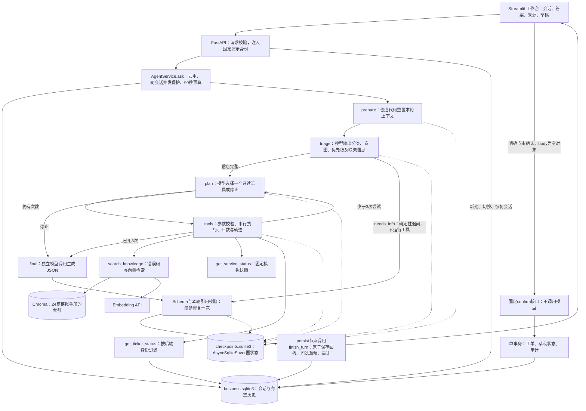

# 第二周：有限工具 Agent 与确认工单的设计研究

项目范围保持中等：一个本地模拟 IT 服务台，处理知识问答、模拟服务状态、当前演示用户的工单查询，以及待用户确认的工单草稿。没有真实企业连接器、登录、管理员审批、自动修复或权限授予。第一周固定 RAG 接口 `/api/ask` 保留；本说明研究第二周的 `/api/sessions/{session_id}/messages` 链路。

## 1. 整体架构与职责

| 源码入口 | 已实现职责 | 边界 |
|---|---|---|
| `app/main.py::create_app`、`lifespan` | API、固定 `DEMO_USER_ID`、启动业务库和 `AsyncSqliteSaver` | 身份为演示常量，不能称为认证或 RBAC。 |
| `app/agent.py::AgentService`、`AgentState` | LangGraph 编排、结构化分诊、最近历史、次数上限、错误转换、指标 | 只有一个 Agent；`prepare` 是普通准备代码，`triage` 是一次模型分类，信息不足走追问。 |
| `app/tools.py::ToolExecutor.execute`、`TOOL_SCHEMAS` | 三种只读能力与严格参数约束 | 不向模型提供创建、确认、取消工单工具。 |
| `app/retrieval/store.py::KnowledgeStore.retrieve` | 复用第一周错误码、邻片段、向量 Top-K | 查询失败不会伪装成成功结果。 |
| `app/providers.py::agent_triage`、`agent_step`、`agent_final` | 分别执行结构化分诊、工具决策和最终 JSON 生成 | 使用兼容 Chat Completions；不假设所有模型支持服务商专有的结构化工具组合。 |
| `app/schemas.py::Triage`、`AgentFinal`、`TicketProposal`、`MessageRequest`、`EmptyRequest` | 分诊、最终模型结果、草稿、请求 ID、空对象的契约 | 格式有效不代表事实正确、用户授权或内容无敏感信息。 |
| `app/business.py::BusinessStore` | 会话、消息、草稿、工单、审计；幂等与事务 | 业务事实以此数据库为准，不能只读图 Checkpoint 判断工单创建成功。 |
| `ui/app.py` | 恢复后端会话、展示工具轨迹与引用、确认或取消草稿 | 用户输入“确认”仍然只是聊天文字，写入由按钮触发固定 API。 |

正常路径由图内 `persist` 节点保存业务结果；图异常时，外层先查业务库是否已提交，已提交则返回既有响应，否则调用同一 `finish_turn` 尽力保存失败响应，不创建草稿。图状态数据库与业务数据库分开，**不存在覆盖两者的分布式事务**，因此图状态和业务提交可能不同时到达；判断已完成响应/工单以业务记录为准。完整历史、回答、工具结果和图状态会明文保存在本机 `data` 目录；这与第一周只存状态、用量的运行摘要不同。当前不实现自动脱敏、静态加密或保留期限管理，请只使用模拟数据，不输入密码、令牌或个人敏感信息。

`data/agent.log` 记录每个节点的运行编号、起止状态、耗时、累计Token和异常类型，最多轮转约3MB，不输出问题/参数或上游异常正文。工具名、参数与结构化结果保存在会话的工具轨迹；如果工具失败导致用量可能缺失，费用保持未知，不给出不完整估算。

## 2. 一条端到端执行链路

下面是可通过 API/页面复现的流程说明；不是在此文档中虚构的一次真实运行记录。具体本次执行结果、次数、耗时和错误见第二周交付记录及其证据文件。

以“VPN-403 仍然连接失败，帮我整理工单交给 IT”为例：

| 步骤 | 关键输入 | 模块与关键输出 |
|---|---|---|
| 1. 建会话 | `POST /api/sessions`，`{}` | `create_session` 返回持久化 `session_id`。API 注入演示身份，不接收客户端 `user_id`。 |
| 2. 发消息 | `POST /api/sessions/{session_id}/messages`，`{"text":"VPN-403 仍然连接失败，帮我整理工单交给 IT","request_id":"vpn-demo-0001"}`（兼容 `question` 字段） | `MessageRequest` 校验长度及请求 ID；`AgentService.ask` 验证所属用户、检查同会话忙状态和重复请求，然后先保存用户消息。 |
| 3. 准备上下文 | 当前问题、该会话此前最近 8 条消息 | `_prepare` 生成系统规则和模型上下文，每条历史最多 2500 字符；重置本轮次数、证据、轨迹和指标。`_triage` 调用模型并用 Pydantic 校验 `category/intent/priority/missing_fields/needs_info`；分类限vpn/email/device/other，意图限排障/服务状态/工单状态/建单/其他；优先级low/normal/high仅为分诊建议，草稿和工单的写入优先级仍固定normal。`needs_info` 必须与非空 `missing_fields` 一致，信息不足先追问，不进入工具循环。历史仅辅助理解指代，本轮事实仍应重新查询。 |
| 4. 选择能力 | 对话上下文、三个工具的 Schema | `_plan` 调用 `agent_step`。合理路径为 `search_knowledge({"query":"VPN-403 ..."})`；具体工具及查询词由模型选择，不保证每次走相同路径。 |
| 5. 只读执行 | 工具名、参数、服务端注入的用户身份 | `_tools` 扣除一次尝试；`ToolExecutor` 校验参数，检索返回 `{ok:true,data:{chunks,embedding_tokens}}`。成功片段合入本轮证据，结果作为 `ToolMessage` 返回模型。错误也返回结构化结果并消耗次数。 |
| 6. 停止或继续 | 已有工具结果、剩余次数 | 若确需服务状态，可再读模拟状态；若信息足够则停止。最多 3 次工具尝试，多工具批次全部拒绝并扣配额，不执行并行工具。 |
| 7. 生成与校验 | 问题、历史、本轮片段、成功/失败的工具轨迹 | `_final` 单独调用 `agent_final`，返回 `answer/citation_ids/evidence_sufficient/ticket_draft`；Schema 和本轮引用集合校验失败最多修复一次。模型没有写入能力。 |
| 8. 保存本轮 | 已校验响应、可选 `title/description/category` 草稿 | `_validate` 确定状态、引用和“尚未创建”的提示；图内 `persist` 节点调用 `finish_turn`，用一个业务事务保存助手回答、草稿及草稿审计。返回 `pending_confirmation`、`draft_id`、来源、轨迹和用量。此时不存在该草稿对应的新工单。 |
| 9. 用户确认 | 用户检查草稿后点击“确认创建”；`POST /api/drafts/{draft_id}/confirm`，`{}` | `confirm_draft` 读取持久化草稿，事务内新增工单、将草稿改为 `confirmed`、写审计；返回同一 `ticket_id`。客户端不能在确认时替换标题、描述、优先级或身份。 |
| 10. 展示与恢复 | 确认响应，或刷新后的 `GET /api/sessions/{id}`、`GET /api/tickets` | 页面恢复历史与当前草稿状态，并展示模拟工单。重复确认返回既有工单；取消待确认草稿后不能再确认。 |

无知识证据时，可以根据用户报告提出待确认草稿，但不会把用户报告升级成已验证知识；回答使用标准证据不足提示，并明确草稿尚未创建。查询状态只说明模拟快照/模拟工单，不证明真实企业服务的当前状态。

同一 `request_id`、同一问题已完成时直接重放业务库结果，不再付费调用模型；若换问题则 HTTP 409。若服务崩溃留下用户消息而没有已提交回答，旧请求返回 `request_interrupted`（409），需要新请求 ID 明确重试。Checkpoint 可保留中途图状态用于诊断，但本版本不承诺从任意中断节点自动续跑。

## 3. 技术九问：最多三次尝试的串行只读 Agent

源码：`app/agent.py::AgentService.__init__`、`_prepare`、`_triage`、`_plan`、`_tools`、`MAX_TOOL_ATTEMPTS`；`app/tools.py::ToolExecutor`；`tests/test_agent.py`。

1. **为什么用？** 同一句话可能要求“查 VPN 手册、看服务是否异常、查某工单”，顺序和需要的能力取决于用户表达与前一步结果。模型先把问题归为明确的分类/意图并指出必要缺失信息，再在三种明确能力间选下一步；普通代码校验Schema、决定是否追问并限制工具集合、顺序和次数，解决“信息够不够、接下来查哪里”的有限决策问题。
2. **不用行不行？最简单方案？** 可以。按“错误码/服务名/工单号”写关键词路由，调用一个函数后生成回答，就能覆盖相当一部分演示题。如果实际问题永远只有固定顺序，应优先这种普通 Workflow。这里保留有界循环，是为了研究需要结合上下文选择工具的实际实现。
3. **替代方案？** 规则路由；一次模型分类后固定 Workflow；自由 ReAct 循环；多个专职 Agent；人工服务台逐项查询。没有为覆盖概念加入多 Agent 或任务队列。
4. **为什么选当前方案？** 成本：规则无需规划Token，本方案增加一次必经模型分诊和后续决策费用，最多三次工具尝试限制消耗；效果：能按上下文追问缺失信息及选择多个来源，规则易漏同义表达，模型则可能错误追问或错分类，尚无对照实验；延迟：串行比并行慢，换取依赖顺序清楚；稳定性：硬上限防止重复循环，自由循环更难定预算；可控性：白名单加明确状态转移，仍无法保证模型每次选对；安全：工具均只读、身份不由模型指定，减少写错风险，提示词不能消除注入；维护：单图和三个工具便于个人掌握，多 Agent 会增加协议、状态和排错成本。
5. **在哪一层，输入输出和调用链？** 在应用编排层。`ask → prepare → triage → plan → tools → plan/final → validate → persist`；分诊信息不足则走追问后校验与保存；输入当前问题、最近历史，依赖 Provider、ToolExecutor、Checkpoint；输出工具轨迹、证据、最终响应。检索工具继续依赖第一周 Chroma/Embedding。
6. **在 Agent 中扮演什么角色？** `triage` 是模型驱动的结构化分诊，`plan` 是下一步能力选择；StateGraph、`prepare`、次数判断和持久化是普通控制逻辑。分诊与工具决策共享一个受控 Agent 流程，不是多个 Agent；服务状态和数据库查询也是普通代码工具。
7. **业务价值及验证指标？** 一个入口能完成几种查询，且可以展开工具轨迹定位错选。应测分诊字段正确率、必要追问率/多余追问率、工具选择正确率、目标任务完成率、每轮调用次数、错误恢复率、P50/P95 和 Token。当前自动化测试能验证上限、参数错误与并行拒绝等契约；真实模型结果以本次交付证据为准，没有生产解决率或优于规则的统计证据。
8. **替换或移除会怎样？依据？** 固定路由会降低调用费用和延迟，但组合表达、追问可能需要补更多规则；放开上限可能支持更长任务，也允许模型反复查询。次数变化来自代码控制流，可确定；准确率变化只是机制推断，需用同一冻结集做规则/Agent 对照，不能直接声称提升。
9. **如何失败？** 分诊JSON/枚举/缺失信息一致性不合规会被Schema拦截，最多修复一次，仍失败则整轮失败，不会把任意文本当分诊；模型提出缺失字段则返回 `needs_info` 追问。不认识的工具、错误参数、非法参数 JSON、同轮多工具都计入尝试预算；多工具整批不执行，三次后强制最终阶段。单次工具执行预算 10 秒，在线 Provider 请求默认 20 秒且 SDK 对瞬时故障最多重试一次；整轮预算 90 秒。无结果或权限过滤失败作为结构化工具结果交给最终阶段，不能视为查询成功；模型/整轮异常返回 `failed`、脱敏错误并尽力保存已完成轨迹。没有自动设备修复或自动派人兜底，页面建议联系人工。

## 4. 技术九问：工具决策与最终 JSON 分开，后端校验来源

源码：`app/providers.py::agent_triage`、`agent_step`、`agent_final`；`app/schemas.py::Triage`、`AgentFinal`、`TicketProposal`；`app/agent.py::_final`、`_validate`；`app/retrieval/store.py::retrieve`。

1. **为什么用？** 工具调用的消息协议与页面需要的最终业务字段不同；兼容接口对强制工具选择和结构化输出支持也有差异。先收集工具结果，再用单独一次普通聊天生成固定 JSON，使最终答案、证据不足、草稿分别可校验。
2. **不用行不行？最简单方案？** 直接展示模型工具循环的最后一段自由文本可以少一次生成调用；但前端难稳定识别草稿和引用，也不便拒绝虚构引用。若只要返回搜索结果而不写自然语言，可完全省掉最终生成。
3. **替代方案？** 服务商原生 JSON Schema/约束解码；把“返回结果”设计为一个特殊工具；正则抽取文本；额外 LLM Reviewer；人工审核全部输出。本项目没有实现 Reviewer 或语义判定模型。
4. **为什么选当前方案？** 成本：正常多一个最终生成请求，异常最多再修复一次，Reviewer还会增加调用；效果：拦住格式和不属于本轮的 ID，不能证明每句话都有依据；延迟：本地 Schema/集合检查很轻，网络生成占主要时间；稳定性：不依赖供应商同时支持 tool calling 与专有响应格式，但仍依赖模型遵守 JSON；可控性：后端只用真实片段构造引用，失败不直接显示未经校验的模型原文；安全：阻止虚构来源，不等于阻止恶意资料影响答案；维护：两种明确 Provider 方法便于测试，代价是提示词和 Schema要保持一致。
5. **在哪一层，输入输出和依赖？** Provider层把工具决策消息转成 `AIMessage`，把最终 JSON 转成 `AgentFinal`；编排层以本轮 `evidence` 核对 `citation_ids`。最终上下文包括问题、历史、工具轨迹和片段；输出回答、引用 ID、充分性和最多一个草稿。
6. **在 Agent 中的角色？** 属于协议适配与输出防护；模型决定如何组织回答，普通代码决定哪些引用能展示以及是否使用标准拒答。它不承担身份认证、工单授权或真正语义审阅。
7. **业务价值及验证指标？** 用户能展开原文，调用方能可靠区分 `answered/needs_info/no_evidence/pending_confirmation/failed`。应测合法 JSON率、修复率、非法引用拦截率、人工逐句证据支持率和误拒答率。测试可证明非法格式/ID被拦；引用存在仅证明可追溯，当前没有生产 Groundedness 数据，不能拿开发召回率代替答案支持率。
8. **替换或移除会怎样？依据？** 移除集合检查即可让模型构造不存在的来源；纯自由文本可能降低延迟但失去稳定字段。原生结构化输出可能提高格式通过率，但需逐供应商验证；Reviewer可能发现语义错配，也可能误判并增加费用。以上预期需实际对照，没有测量就不报收益百分比。
9. **如何失败？** JSON、字段长度/分类或引用校验失败时最多重试最终生成一次，不重新运行所有工具；仍失败返回失败状态。模型判断证据不足，或本轮既无知识片段也无成功状态查询时，后端使用标准拒答。成功服务/工单查询允许无文档引用的状态回答；这不等于已证明混合回答中的每个知识句有引用，仍需人工语义复核。草稿无证据时也只能是用户报告的待确认记录。模型 API异常通过 `api_error` 脱敏，日志不打印上游正文/密钥；没有自动语义修复循环。

## 5. 技术九问：异步 Checkpoint 与业务持久化分责

源码：`app/main.py::lifespan`；`app/agent.py::ask`、`_persist`、`_busy`；`app/business.py::append_message`、`get_request`、`finish_turn`；`tests/test_business.py`、`tests/test_agent.py`。

1. **为什么用？** 刷新页面或重启服务后，用户应能找回已完成会话与待确认草稿；模型图中途故障还需要查看已完成的节点和工具轨迹。只保存浏览器变量会丢历史，只把 Checkpoint 当工单表又缺少稳定业务约束，所以分开存储。
2. **不用行不行？最简单方案？** 单进程内存字典即可做一次演示，但重启即丢。若只要求恢复已完成聊天，单独业务 SQLite 就够；Checkpoint 的额外价值是保存图执行状态与诊断，当前不承担工单业务真相。
3. **替代方案？** 浏览器 session state；仅业务 SQLite；SQLite 同步 Saver；PostgreSQL Checkpointer与业务库；Redis历史；数据库锁或队列协调多工作进程。本项目只跑一个后端进程，不引入服务集群。
4. **为什么选当前方案？** 成本：两份本地文件，无额外服务，重复状态增加磁盘占用；效果：恢复完成会话并保留图状态，不等于自动断点续跑；延迟：Checkpoint有节点写盘开销，SQLite业务方法用 `to_thread`，异步图使用 `AsyncSqliteSaver`避免同步Saver不支持异步接口的问题；稳定性：业务提交事务明确，但两库没有跨库事务；可控性：业务历史固定只送最近8条，避免全量上下文持续增长，代价是更早指代可能丢失；安全：所有权过滤和请求去重限制串会话/重复草稿，明文文件仍有本机读取风险；维护：SQLite适合个人演示，多进程时内存忙状态不够，需重新做并发协调。
5. **在哪一层，输入输出和调用链？** `lifespan` 创建异步Saver并编译图，`thread_id=session_id`；`ask` 从业务库读完整历史，再取最近8条构造模型输入。用户消息先存；图内 `persist` 节点调用 `finish_turn` 一次事务存助手结果与可选草稿。读会话以业务表为准。
6. **在 Agent 中的角色？** Checkpoint是执行状态存储；业务表是应用数据；历史是有限上下文，不是长期记忆检索系统。请求ID和同会话忙保护是普通幂等/并发控制，不能包装成模型智能。
7. **业务价值及验证指标？** 用户刷新后能继续查看已完成答案，网络重发不会重复产生草稿。应测重启前后历史/草稿一致性、重复请求模型调用次数、孤立草稿数、写入失败回滚及同会话冲突率。仓库测试覆盖恢复和事务故障等具体路径，运行验收可证明这次进程重启行为；没有多机、高并发或长期数据迁移成绩。
8. **替换或移除会怎样？依据？** 删除业务持久化会失去稳定工单与幂等记录；只删Checkpoint仍能恢复业务完成历史，但失去图节点诊断信息。取消历史截断会增加Token和延迟，可能保留更早语义，也可能带入陈旧事实。当前没有对话长度对照实验；单进程忙保护明确不能推广成分布式锁。
9. **如何失败？** 已完成同ID/同问题直接重放结果，换问题409；已收用户消息但未提交结果的旧ID返回 `request_interrupted`，需新ID重试，不自动重放有风险节点。同会话在处理时返回 `session_busy`，不同会话可独立处理。图异常可读取最后Checkpoint提取已有轨迹，但Checkpoint失败也可能导致本轮失败。`finish_turn`的草稿/回答/审计一起回滚；本地存储不可用返回503。SQLite等待锁最多5秒；无自动数据库修复、加密、清理或人工任务调度。

## 6. 技术九问：模型提议草稿，固定确认接口原子创建工单

源码：`app/schemas.py::TicketProposal`、`EmptyRequest`；`app/agent.py::_validate`；`app/business.py::finish_turn`、`confirm_draft`、`cancel_draft`、`get_ticket`；`app/main.py::confirm`、`cancel`；`ui/app.py`。

1. **为什么用？** 自然语言“帮我看看/帮我开单/确认”可能含糊，模型也可能误称已经执行。先把标题、描述和分类存为可检查草稿，再由用户明确点击，防止模型输出直接变成业务写入；事务则处理用户双击、网络重试和中途写盘失败。
2. **不用行不行？最简单方案？** 传统工单表单让用户自己填字段，完全可以完成此业务，且更可控。AI的可选价值是从对话整理草稿；即使移除AI，确认、事务与权限边界仍应保留。
3. **替代方案？** 模型直接调用 `create_ticket`；聊天中检测“确认”后提交；客户端提交整份可改草稿；传统表单；真实审批引擎。当前没有接入审批人、企业角色或真实工单系统。
4. **为什么选当前方案？** 成本：多一次用户检查和一次本地HTTP，减少重复/误建工单的潜在处理成本但尚无实际财务数据；效果：用户可核对归纳错误，不能保证一定读过；延迟：提交无需模型，主要为本地事务等待；稳定性：唯一 `draft_id` 与事务抵抗重复确认和半提交；可控性：确认只接草稿ID和空对象，字段从数据库读取，优先级固定normal；安全：后端所有权过滤，模型无写工具，但固定演示身份不构成真实访问控制；维护：几个明确状态和SQL足够，审批平台会增加角色、流程配置和运维负担。
5. **在哪一层，输入输出和调用链？** 模型输出 `TicketProposal` 进入业务层 `finish_turn` 保存pending草稿；用户按钮调用 `/api/drafts/{id}/confirm`，`confirm_draft` 执行 `BEGIN IMMEDIATE → 读草稿及所有者 → 插工单 → 改状态 → 插审计 → commit`，输出ticket+draft。取消走独立固定接口。
6. **在 Agent 中的角色？** LLM承担分诊、查询决策、信息归纳和草稿提议；草稿持久化在图内普通代码节点完成，工单创建仍是图外确定性业务流程。用户确认是本地操作确认，不是真实管理员批准，更不能称为自动授权或企业权限系统。
7. **业务价值及验证指标？** 目标是让用户少重复录入并避免误建/重复单。可测草稿字段人工修改率、草稿确认/取消比例、重复工单率、事务故障后不一致行数、越权读取拦截率。自动化测试验证幂等、所有权及注入审计写失败后的回滚；未测真实员工节约时长、采纳率或企业工单解决率。
8. **替换或移除会怎样？依据？** 直接模型创建会省一次点击，但错误意图可能落库；聊天关键词确认易把示例、引用或注入当意图；客户端重传字段允许确认时内容变化；去掉事务可能留下工单已插入而草稿仍pending的中间状态。唯一约束和失败注入测试提供机制证据，不能因此声称抵御全部恶意请求或达到生产安全标准。
9. **如何失败？** 外人资源与不存在资源同为404；非空确认字段由 `EmptyRequest(extra='forbid')` 拒绝。重复确认返回同一ticket，不重复审计；重复取消返回cancelled，取消后确认409，确认后取消409。事务内任何SQL失败一起回滚；若响应丢失，重试确认读取既有ticket。草稿状态异常不伪造成功，存储异常返回503。模型不可关闭工单、授予VPN权限或执行排障；必要时用户自行联系人工，系统没有真正的派单通知与人工审批集成。

## 7. 业务五问

1. **为什么做？谁使用、频率和原流程痛点？** 目标用户是假想员工和IT服务台：员工描述VPN、邮箱、打印问题时，需要在零散手册、状态页和工单页之间切换；升级人工又要重复描述。项目提供统一查询与草稿整理入口。没有真实企业用户访谈、请求量或日活数据；24篇手册和模拟状态只是练习载体，使用频率是假设，不能写成已验证需求。
2. **为什么需要AI，哪些步骤适合普通代码？** 模型用于结构化分类/识别缺失信息、理解自然语言追问、选择有限工具、把证据组织成回答、把用户报告归纳成草稿；Embedding用于同义表达的知识召回。规则能解决明确错误码/工单号路由，普通代码必须负责次数、参数、所有者、引用集合、幂等、事务、状态机和用户确认。若需求只有固定FAQ或标准表单，不用Agent也能成功；采用AI的收益要靠任务完成率和用户修订成本验证。
3. **如何判断成功，真实数据在哪里？** 工程成功先看会话可恢复、三次上限不突破、三类只读工具可用、无确认不建单、重试不重复、故障不半提交。质量看独立冻结集的正确工具率、任务完成率、拒答误判、人工证据支持率及草稿事实一致性；体验/成本看P50/P95、规划/最终生成次数、Token和已知单价估算费用；风险看越权与误提交测试。`tests/test_agent.py`、`tests/test_business.py`及第二周交付证据提供测试/本地运行依据；第一周开发集不是第二周生产指标。第三周的冻结评测与对照实验尚需按计划完成，没有真实ROI、SLA或降低工单百分比。
4. **系统边界和责任怎样分？** 模型和工具只能读取模拟资料与当前演示用户工单；草稿经用户按钮明确确认后才写本地数据库，真实授予权限、修复设备、关闭工单、企业审批由人及正式系统决定。固定身份只能演示数据分区，无真实登录/RBAC；本地明文存储和模型请求不适用于敏感资料。服务状态明确标模拟快照，不能当成企业实时监控结果；不以工具失败或资料不足冒充成功。
5. **剥离团队/框架能力，候选人实际做了什么？** 项目实现范围包括工具边界与参数契约、有限状态图、查询证据累积、输出校验、会话/请求幂等、草稿确认事务、页面和故障测试。LangGraph调度/Checkpoint、Pydantic校验、SQLite事务、Chroma向量库、FastAPI/Streamlit和模型本身都是已有能力。此代码由AI辅助生成和验证，候选人应如实注明辅助方式；只有自己能解释、修改并复现测试的部分，才可表述为掌握，不能直接声称全部手写、自研Agent框架或拥有企业上线结果。若实际多人协作，应另列本人负责模块及提交证据，本仓库没有可证明真实团队分工的生产履历。

面试演示建议沿“查询证据 → 多轮追问 → 模拟状态/工单 → 提议草稿 → 取消或确认 → 重试与恢复”展示，并展示一个受控失败。可确认的工程行为与尚未验证的业务收益应分开陈述。

## 8. 本次交付的源码行号索引

行号由当前Python源码读取；修改后应重新核对。各技术点的实现与测试符号见前文。

| 源码 | 符号 | 行号 |
|---|---|---|
| `app/agent.py` | `AgentService` | 46 |
| `app/agent.py` | `AgentService.__init__` | 47 |
| `app/agent.py` | `AgentService._prepare` | 111 |
| `app/agent.py` | `AgentService._triage` | 141 |
| `app/agent.py` | `AgentService._plan` | 161 |
| `app/agent.py` | `AgentService._tools` | 203 |
| `app/agent.py` | `AgentService._final` | 272 |
| `app/agent.py` | `AgentService._validate` | 310 |
| `app/agent.py` | `AgentService._persist` | 358 |
| `app/agent.py` | `AgentService.ask` | 384 |
| `app/providers.py` | `OpenAIProvider` | 48 |
| `app/providers.py` | `OpenAIProvider.agent_triage` | 142 |
| `app/providers.py` | `OpenAIProvider.agent_step` | 181 |
| `app/providers.py` | `OpenAIProvider.agent_final` | 189 |
| `app/business.py` | `BusinessStore` | 46 |
| `app/business.py` | `BusinessStore.finish_turn` | 256 |
| `app/business.py` | `BusinessStore.confirm_draft` | 312 |
| `app/business.py` | `BusinessStore.cancel_draft` | 341 |
| `app/business.py` | `BusinessStore.get_ticket` | 363 |
| `app/tools.py` | `ToolExecutor` | 62 |
| `app/tools.py` | `ToolExecutor.execute` | 66 |
| `app/schemas.py` | `TicketProposal` | 107 |
| `app/schemas.py` | `AgentFinal` | 121 |
| `app/schemas.py` | `MessageRequest` | 132 |
| `app/schemas.py` | `EmptyRequest` | 137 |
| `app/schemas.py` | `Triage` | 141 |
